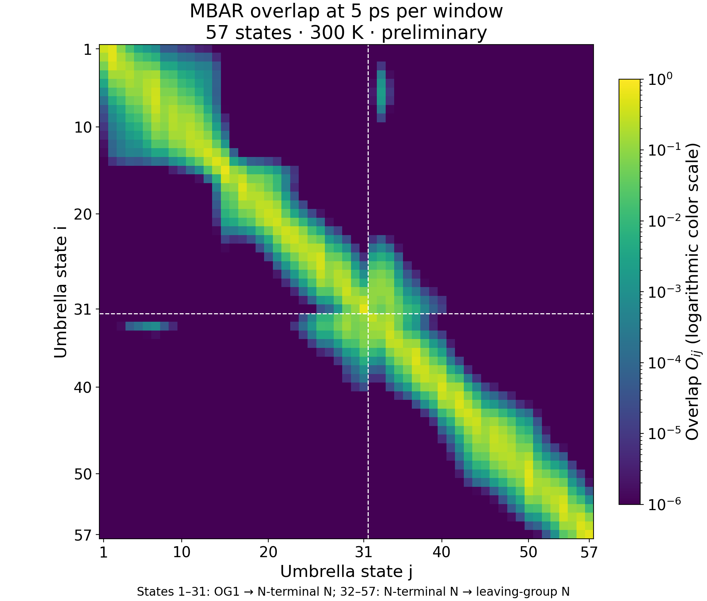

# Relay-US sampling support and model qualification — 25 November 2026

## Current 5 ps evidence

All 57 windows have an accepted first 5 ps block at 300 K. The full production
CSV dataset contains 5700 frames. The existing equilibration detection and
conservative decorrelation selection retain 749 samples for MBAR. The pooled
target-ensemble ESS is 12.66; it is not a minimum per-window ESS. All selected
per-window counts (3–49) remain below the predeclared 100-sample gate.

| Normalized path-bin center | All production frames | After equilibration discard | Decorrelated MBAR samples | Diagnosis |
| --- | ---: | ---: | ---: | --- |
| s=0.1125 |21|3|0|Sparse support after equilibration/decorrelation selection; the region was visited by MD. |
| s=0.6875 |69|Not separately tabulated|17|The original weighted histogram rounded a small positive mass to zero. |

The second bin has stable probability mass 1.0491574733895156e-20 and a
corrected PMF value 20.6091 kcal/mol above the same E–S reference. This is the
highest sampled bin, **not an accepted activation barrier**. The first bin
remains empty in the estimator, and sampling/chemical-channel validation is
incomplete. Its neighboring projection ambiguity margins are also small
(0.0027–0.0499 Å), so a one-dimensional gap alone cannot identify a missing
physical pathway region.

The full MBAR overlap graph is connected at the existing 0.001 edge threshold.
The more demanding neighboring-window 3CV histogram-intersection gate still
fails. Connectivity permits relative normalization; it does not establish
adequate local sampling, correct channel identity or convergence. Tiny overlap
between distant states is expected and is not itself a failure criterion.

## Numerical correction

The weighted histogram implementation used cumulative-sum subtraction through
`numpy.histogram` with explicit edges. In a representative regression,
weights [1, 1e-20, 2e-20] in three separate bins produced [1, 0, 0]. Direct per-bin
accumulation preserves all three positive masses. The corrected helper also
reports raw per-bin counts and restricts a reported path maximum to the
resolved E–S-to-acylenzyme interval, excluding empty exterior bins.

No bin edges, temperatures, bias potentials, physical Hamiltonians, trajectory
frames, equilibration/decorrelation rules or chemical filters were changed.
Original reports remain under the checkpoint's
`before_weighted_histogram_precision/` archive. The corrected reader runs in a
new frozen analysis watcher; all native MD continues. The repair record is
`analysis/histogram_precision_correction_20261125/repair_acceptance.json`
under the campaign. The shared inspection paths remain unchanged.

## Decision at the 10 ps and 15 ps checkpoints

1. Keep the current windows running. Recompute full-frame, post-equilibration
   and decorrelated occupancy with stable bin accumulation on the same grid.
2. Inspect neighboring distributions in the actual restrained CVs, plus
   projection ambiguity and proton ownership. A histogram hole by itself is
   insufficient evidence for an additional umbrella.
3. If independent coverage and local overlap remain weak at successive
   checkpoints, prepare targeted bridging windows using compatible physical-CV
   centers and validated neighboring seeds. Rare correlated visits do not
   rule out a bridge. Verify projection/channel behavior first; more windows
   alone cannot repair an unsuitable projection or unresolved orthogonal state.
4. Preserve all samples and predeclared convergence gates. Continue at least
   the approved 30 ps/window; additional sampling remains conditional on the
   existing block/uncertainty/independent-start and chemical checks. Do not
   smooth over gaps or report 20.61 as a converged barrier.

Adequate neighboring overlap and sampling convergence are distinct checks;
intermediate windows can help when local overlap is insufficient. See the
[official GROMACS umbrella-sampling tutorial](https://gromacs.gitlab.io/online-tutorials/website/docs/umbrella-sampling.html)
and [PyMBAR FES documentation](https://pymbar.readthedocs.io/en/latest/fes_with_pymbar.html).

## Historical comparison

There is no retained, matched all-window 5 ps checkpoint for the previous
63-window direct-NEB campaign. Early analyses had unrun windows: the first
connected update contained 46/63 windows. The first all-window update mixed
5 ps and 20 ps production, so it is not comparable to the present 57 × 5 ps set.
Its 2D weighted FES included many zero-mass bins, including at 30 ps/window;
these cannot be equated to holes along a one-dimensional reaction path, and
raw per-bin counts were not recorded there.

The earlier 20-window direct-PT 2 ps summary and 25-window asynchronous smoke
summaries had finite values in all reported 1D bins. The asynchronous elapsed
durations were not established by those saved summaries. Coordinates, bin
ranges, coverage and support definitions differ: the records do not justify
claiming that complete 5 ps PMFs invariably show gaps or that more time always
removes them. Full evidence and hashes are in
`provenance/historical_us_gap_comparison_20261125.json` and
`provenance/relay_us_gap_audit_20261125.json`.

## Model policy

The observed scientific-planning gap supports retaining GPT/PI leadership for
open-ended reasoning and method changes, while using Nemotron within its
qualified read-only evidence/citation scope. The completed benchmark compared
Nemotron with Mistral, not GPT-6.1 Sol Ultra. Context, tools, inference budget
and quantization were not matched against the GPT-assisted workflow, so no
head-to-head score or causal attribution is established. Numerical and
scientific checks apply to every model. The private mechanism-agent repository
contains the portable 20-case qualification summary and source; raw research
artifacts remain on the workstations.
