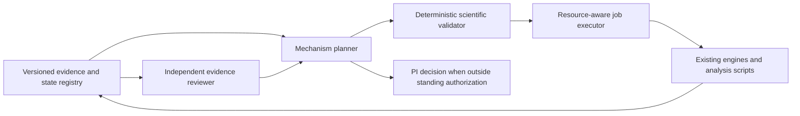

# Local agent workflow for Nyl12–PA6 mechanism research

## Current recommendation — 2026-11-19

**A bounded local prototype is worthwhile. Start with evidence auditing and
job diagnosis, then permit validated workflow execution after qualification.**
The user authorized a separate `mechanism-agent` repository for this design,
with a documentation-first scaffold; scientific jobs/data stay in the existing
research repositories. No deployment is implied by repository creation.

A local LLM is a planner/reviewer around our scientific tools; its agreement
with another persona does not validate a mechanism. Keep the current QM/MM
and MD work independent of building a general autonomous-laboratory platform.
This is a design proposal; no LLM download, server, new dependency or separate
project has been installed/launched. The separately authorized US/MD runs
continue through their ordinary scripted/tmux workflows.

The PI now reports **two 96 GB GPUs on azalea**. This supersedes the older
two-48-GB hardware assumption in the historical note below. Verify actual GPU
architecture, driver/CUDA compatibility, free VRAM and backend support before
deployment. No reboot, mount or system configuration change is implied.

### Models and no-API-key deployment

| Official model | Proposed role | Hardware/qualification basis |
|---|---|---|
| OpenAI gpt-oss-120b | Initial reasoning/planning candidate | Official native-MXFP4 release is documented to run on one 80 GB GPU; a 96 GB card is a plausible fit with conservative context/batch sizes, subject to local backend validation. |
| Google Gemma 4 31B | Different-family critic and alternative baseline | Official dense 31B model with native function calling/structured output; measure actual memory, tool accuracy and chemical reasoning rather than treating its parameter count as competence. |
| OpenAI gpt-oss-20b | Optional fast extraction/triage worker | Officially documented for 16 GB-class inference; use only tasks it passes on our evaluation set. Same family as 120b does not provide independent corroboration. |

Use official weights and pin revisions, hashes, license, precision, tokenizer
and tool/chat template. The standing restriction excludes Chinese-origin
models **and derivatives**; do not substitute a community checkpoint whose
base-model provenance is unclear. These OpenAI/Google candidates fit the
stated origin constraint, but no Nyl12 competence is established yet.

A self-hosted inference endpoint needs no paid external inference API key.
The model server and scientific tool service are local processes. A single
120b server on one GPU, with a second GPU available for a different-family
reviewer or scheduled MD, is a sensible first layout. Two cards are not
automatically one pooled 192 GB allocation. Do not occupy both merely to
maximize parameter count. Begin at 8–16k working context and bounded output;
record real peak VRAM, time per decision, malformed tool calls and correctness.

Existing Ollama can be assessed if actually installed/qualified; vLLM is a
reasonable serving candidate if a new deployment is approved. Use native
model-specific tool templates and schema-constrained requests, not regex
repair followed by an assumed scientifically valid action. New production
dependencies require approval and an isolated environment managed with uv.
No remote fallback is assumed.

Official references checked for this proposal:

- https://openai.com/index/introducing-gpt-oss/
- https://github.com/openai/gpt-oss
- https://blog.google/innovation-and-ai/technology/developers-tools/gemma-4/
- https://mistral.ai/news/mistral-small-4 (reviewed alternative; vendor
  full-serving hardware recommendation exceeds this initial single-card
  plan, so no unverified local-fit claim is made).

### Architecture: a scientific state machine with bounded LLM decisions

The state registry is a chemical reaction graph: every node declares atom
mapping, proton inventory, connectivity, total charge/spin, substrate register,
QM/MM partition, Hamiltonian and evidence. Edges specify the chemical event
and observable changes, not merely an instruction to shorten a distance.
Acylation and deacylation both belong to the overall hydrolysis problem;
precursor autocleavage is a separate process. Stable TI1 is a hypothesis, not
a mandatory state the software must manufacture.

Use six specialists plus a coordinator, served by one or two model servers
rather than seven continuously resident models. Roles are extensible; the
initial scope is deliberately bounded:

| Role | Responsibility and required deliverable |
|---|---|
| Literature/evidence specialist | Search primary papers and supporting information, retrieve originals through the existing Paperclip interface, and produce a claim ledger with DOI, page/figure, evidence type, limitations and local source hash. |
| Enzymology/mechanism specialist | Interpret catalytic chemistry, proton inventories, conserved-residue roles, substrate/product identity, assay conditions and competing pathways; propose a discriminating experiment/calculation with predicted outcomes. |
| Structural biology specialist | Assess crystal/model provenance and uncertainty, mature-chain identities, substrate register and signed Herschlag phi, catalytic rotamers, water access, tetramer symmetry and consistent atom mapping; return mapped structural evidence rather than confidence scores alone. |
| QM/QM-MM specialist | Translate the mechanistic test into a declared Hamiltonian, QM partition, charge/spin/proton inventory, PES/TS protocol, electronic/force gates and cost estimate. |
| MD/free-energy specialist | Specify matched ensembles and seeds, restraints and boundary conditions, US CVs, sampling/overlap/ESS diagnostics, and the limits of a PES-versus-PMF comparison. |
| Coordinator/planner | Select one bounded next action from the evidence and cost, retain rejected hypotheses and stop conditions, and refer genuinely new scope to the PI. |
| Independent scientific critic | Inspect original sources/metrics before the proposed conclusion, challenge alternative explanations and unsupported claims, and flag critical scientific errors. Agreement is not experimental validation. |

The **executor/controller is deterministic Python**, not another scientist
persona. It validates a declarative job proposal, acquires CPU/GPU resources,
calls an allowlisted tested adapter and retains immutable inputs, environment,
native output, hashes and separate acceptance records. Protected scientific
fields cannot be changed by a meeting vote. The human PI resolves ambiguous
chemistry and authorizes genuinely new scope; standing authorization continues
to cover ordinary validated continuations.

The structural biology role must distinguish observed electron-density-backed
conformations from uncertain modeled loops/ligands, account for alternate
conformers and chemically equivalent Asp oxygens, and preserve residue/chain
mapping across models. Opposite signed Herschlag phi identifies flipped local
substrate poses only with a consistent scissile-amide definition. Structural
confidence, Tier A occupancy and proximity are not proof of catalytic activity
or a particular protonation state. Evidence must cover all equivalent active
sites when comparing a symmetric tetramer.

The enzymology role is essential to the research reasoning, not an optional
summary writer. It must separate mature-enzyme hydrolysis from precursor
autocleavage, distinguish structural inference from mutational evidence
confounded by failed maturation, and test whether analog-enzyme mechanisms
actually transfer to Nyl12 and a polymeric substrate. It checks leaving-group
protonation, acylation versus deacylation, neutral/cationic Thr N, Asp272/274,
water access and proton/charge balance. The role must not require a stable
TI1 just because it was included in the initial mechanism scheme. Predicted
rates and proposed protonation states require appropriately qualified evidence.
It should have a compact curated NylC/N-terminal-nucleophile evidence packet,
including Negoro 2023 and Andjelkovic 2023 with supporting-information identity.

### Human-in-the-loop scientific leadership

The human PI directs the study and decides between scientific hypotheses.
Agents provide cited analysis and executable proposals; they do not vote a
mechanism into acceptance. PI instructions, corrections, questions and
decisions belong in durable project state, not only a chat transcript.

The initial interface should be a **decision inbox plus readable reports**,
backed by versioned files and a small CLI after the read-only pilot. The PI
can read/revise these through the existing Codex workflow without an external
LLM API key. A dedicated local browser dashboard is a later interface option,
not a prerequisite or something installed by this repository scaffold. It
would show one research question per card, evidence links and comparison
plots, rather than raw schemas or seven agents' unfiltered conversations.

Each decision packet contains: the question; observed facts versus inference;
competing hypotheses and contrary evidence; a recommended next calculation
and predicted discriminating outcomes; charge/proton inventory/mapping/QM
region/method/temperature/restraints; resource/time estimate and budget;
success/failure/stop conditions; and links/hashes for original artifacts.
The PI can approve, edit, reject, hold, request another option, or ask a named
specialist. Comments such as “compare a water relay before another direct
route” become authored guidance linked to the affected question and plan.
An ambiguous comment is not treated as permission to launch new chemistry.

Approvals apply to an exact plan version and input identities. Material
changes outside the approved envelope return to the inbox. Record who
approved what, when, the rationale and any scope/budget conditions. Retain
rejected options and superseded decisions. A PI override can select a
scientific hypothesis, but must not silently transform unconverged forces,
wrong charge or an unverified saddle into validated results.

Standing authorization persists: ordinary reads, plots, monitoring and
already-approved continuations/extensions within explicit limits proceed
without repeated approval. New protonation/connectivity, Hamiltonian/QM
partition, substantial unapproved campaigns, dependencies and externally
published/shared material require PI review unless specifically covered.
Ask only for decisions that materially change scope; do not create a new
permission hurdle for routine reversible work already authorized.

“Pause new work” stops dispatch while preserving running jobs. “Stop this
job” targets only a verified selected process, retaining its checkpoint and
logs. Show these as distinct controls, including the scope of any broader
stop. While the PI is offline, already-authorized scripted/tmux jobs and
analysis continue. A genuinely new scientific decision waits in the inbox;
agents must not manufacture approval from elapsed time. Optional alerts
require explicit channel authorization; none is configured now.

### Paperclip retrieval and evidence discipline

The previous `redesigner-agent` adapter was inspected directly. Its
`PaperclipProvider.consult` calls `paperclip search`, extracts a search result
ID, then invokes `paperclip map`. The current violet CLI is installed and
`paperclip --help` succeeds. Help documents automatic sign-in and an OAuth
login or an optional Paperclip API key for noninteractive use. This is
separate from an external **LLM inference** API key. Existing authentication,
current command availability, publication access and the provider behind
`map` have not been verified; no credentials were read or changed and no
literature campaign was launched during this design review.

Reuse publication discovery/retrieval capabilities, not the old meeting loop.
Qualify the installed Paperclip interface before coding a new adapter; older
search/map commands are not assumed to be unchanged merely because an older
wrapper used them. Give Paperclip only the bounded retrieval task. Preserve
original PDF/SI/text and source identities locally, then give retrieved text
to an approved local model. Do not assume a Paperclip-hosted summarization
step is local, free, or uses an origin-compliant model. Verify it explicitly
before use or omit that summarization step and analyze the originals locally.
No access-control circumvention or automatic upload of unpublished project
data is part of this design.

Literature outputs must distinguish: direct NylC/Nyl12 observations versus
homolog inference; hydrolysis versus maturation; measured protonation versus
a proposed assignment; experiment versus computation; full text versus abstract
only; and absence of evidence versus evidence of absence. A model-generated
summary is a lead, not an accepted citation. Record title/DOI, source version,
exact page/figure/table, a concise claim, contrary evidence, access limitations
and an original-file hash. The enzymology specialist consumes this ledger and
checks chemical relevance; it should not independently repeat the same broad
search on every simulation update.

Wake these roles when needed: literature plus enzymology at a mechanistic
question or new relevant paper; structural biology for coordinate/model
selection or suspicious geometry; QM/QM-MM and MD/free-energy specialists
for their respective protocol design or failure diagnosis; critic before a major interpretation/expensive branch;
coordinator at meaningful milestones. Code monitors jobs, updates plots and
evaluates routine gates without LLM calls. Cache validated evidence and use
short task packets. Multiple roles do not require an all-hands roundtable or
multiple model calls at every MD step.

### Scientific tools and execution boundaries

Reuse current validated entry points as typed tool adapters:

- **Molecule/state preparation:** graph/atom mapping, mature-chain termini,
  proton inventory, integer-charge/counterion checks, parameter release hashes.
- **QM:** prepare/run/parse Gaussian geometry, frequency, ESP/RESP and small
  benchmark jobs; run installed xTB methods with explicit method/charge/spin.
- **QM/MM:** prepare and run Sander DFTB3 or other explicitly validated
  Hamiltonians, coordinate driving, NEB, DL-FIND optimization, Hessian/mode
  checks and downhill connectivity. Never label a NEB/PMF maximum a verified
  first-order saddle. Preserve electronic-convergence checks independently.
- **Classical MD:** existing ff19SB/TIP3P/PA6 release preparation, pmemd.cuda
  queues, replica seeds, full-system unrestrained production, geometric and
  native-Thr/signed-phi/site-aware analyses. Fixed-topology MD cannot establish
  proton-transfer kinetics or equilibrium protonation fractions.
- **Free energy:** explicit CV/bias definitions, US execution, native-bias
  cross-evaluation, MBAR, autocorrelation/ESS, overlap, block stability and
  proton-permutation-invariant observables. Preserve alternate chemistry;
  do not silently censor trajectories to obtain a desired pathway.
- **Literature/evidence:** local PDFs/text plus primary-source retrieval with
  DOI/page/figure/claim references, corrections and rejected results retained.
- **Reporting:** compact state dashboard, VMD exports, figures and numerical
  manuscript claims that cite specific machine-readable artifacts.

The executor accepts job types/specifications rather than unrestricted shell
text. It must not silently change charge, method, QM selection, restraints or
units; lower acceptance thresholds; reinstall software; or touch boot/mount
configuration. Existing standing authorization covers routine continuations
within declared limits. Ask the PI only for genuinely new scientific scope
or actions outside that authorization. Do not add approval to every normal
job. Preserve unrelated researchers' processes and use resource leases.
CPU-only PyMBAR/JAX analysis must explicitly avoid GPUs allocated to MD.

Machine learning is optional later: cost prediction, hypothesis prioritization
or choosing poorly sampled US windows are useful bounded applications. No
new reactive MLP training is part of the initial plan. An existing potential
would still need a relevant chemical-domain validation before replacing a
Hamiltonian.

### Existing open-source components to qualify

Before adding infrastructure, assess reusable components against the same
evidence tests. Argonne's ChemGraph supports tool-backed computational
chemistry and an Ollama local provider without a paid API key; it is a design
reference/optional candidate, not an adopted dependency or a proven Amber
QM/MM mechanism solution: https://github.com/argonne-lcf/ChemGraph .
quacc provides composable Gaussian and xTB/DFTB recipes that may be useful
where they save adapter work, while Amber/Sander and our acceptance rules
remain explicit project tools:
https://quantum-accelerators.github.io/quacc/install/codes.html and
https://quantum-accelerators.github.io/quacc/user/recipes/recipes_intro.html .
Do not replace tested project adapters merely to adopt a framework.

A scheduler must distinguish a queued message from an actually scheduled
task and verify worker liveness before waiting. In this Codex session,
`send_message` does not resume completed helpers; `followup_task` is required.
That operational distinction belongs in the durable run state.

### Durable memory and provenance

Keep JSON/JSONL job/state records authoritative, CSV for tables, and short
Markdown methods/decisions/manuscript summaries. A SQLite/FTS index can be a
rebuildable search aid; a new vector database is unnecessary initially.
Retrieve a small evidence packet for each decision instead of inserting the
entire conversation or raw logs into every prompt. Record model revision,
precision/template, prompt, tool requests/results, concise decision rationale,
input/output hashes, environment and rollback guidance.

Separate process completion, electronic convergence, chemical state, force
convergence, saddle verification, geometric acceptance and sampling
convergence. An alternate proton state is data; a physically unsupported
QM/MM boundary crossing or unconverged electronic force is a model failure.

### Qualification before autonomous submission

Build 20–30 reviewed archived cases from this project, with held-out cases.
Include the MCCE false-success/terminal failures, the corrected crystal TER
case, ASH charge changes, changed atom indices, atom-label proton exchange,
unconverged NEB maxima, neutral-Thr charge bookkeeping, masked/frozen region
conversion and heating-versus-production temperature gates. Test original
artifacts, not only narrative summaries of the answers.

A first pass should reproduce correct evidence extraction and propose the
next bounded experiment. Any critical charge/proton/mapping or unsupported
claim error blocks unrestricted submission; a small evaluation cannot certify
future correctness. Compare researcher review time and decision quality with
a single-model baseline and our deterministic queues. Promote only tool
templates that demonstrate useful reliability. Initial autonomous permission
should be narrow, such as extending already approved US sampling based on
measured diagnostics within a fixed resource ceiling.

### What was learned from redesigner-agent

The requested README was inspected at
`/data/jpc/code/redesigner-agent/README.md`. Useful ideas include a single
campaign specification, explicit stage adapters, durable state, protected
chemical/sequence identities, cached expensive work and retained decisions.
Its documented architecture also has expert meetings, optional fail-open
behavior after meeting errors, adaptive promotion/geometry thresholds and
a substantial orchestration layer. The README records malformed-JSON meeting
failures and related hardening; it does not establish why the overall
scientific effort was unsuccessful.

This proposal does not adopt that implementation or run its design loops.
The first deliverable is a read-only literature-and-enzymology evidence
auditor/diagnostician against our current artifacts, followed by a bounded
validated executor.
The current mechanism work should proceed while that prototype is evaluated.

---

## Historical concept retained from 2026-10-24

The hardware/model recommendations below are historical and superseded by
the current proposal where they differ.

# Proposed local agents for the Nyl12 PA6 mechanism project

2026-10-24. **Standing constraint: no Chinese-origin LLMs or derivatives.**
Model provenance must satisfy that constraint before selection. Concept only:
no model downloads, installations, dependencies or scientific jobs authorized.

A local team can organize evidence and run approved reproducible workflows
alongside the staged DFTB QM/MM plan. It cannot guarantee a complete mechanism.
Personas are semantic roles, not independently qualified scientists; agreement
is not scientific evidence. Protonation, connectivity, QM-region/embedding,
method validation and sampling convergence remain the substantive work.

## Hardware and candidate models

Two RTX A6000 cards provide 48 GB ECC GDDR6 each, with optional two-way NVLink.
Bridge presence is unverified. Installed 96 GB is not automatically one pooled
allocation; software must shard weights/cache across devices.
[Retained official NVIDIA specifications](https://www.nvidia.com/en-us/products/workstations/rtx-a6000/)

| Candidate | Proposed use and conditions |
|---|---|
| **gpt-oss-20b** | Routine evidence extraction, bounded planning and scripting baseline: 21B total/3.6B active parameters; Apache-2.0; 131,072-token advertised context. First qualify actual Ampere runtime support. |
| **gpt-oss-120b** | Conditional higher-capacity scientific reviewer: 117B total/5.1B active parameters, Apache-2.0 and 131,072 context. A two-GPU quantized trial may be feasible; no measured local fit/speed claim. Same family as 20b, so not independent corroboration. |

[Official 20b documentation](https://developers.openai.com/api/docs/models/gpt-oss-20b),
[official 120b documentation](https://developers.openai.com/api/docs/models/gpt-oss-120b).
Neither establishes Nyl12 chemistry competence.

The official OpenAI local guide quotes about 16 GB for 20b with MXFP4 and
at least 60 GB or multiple GPUs for 120b, but its stated MXFP4 fast path requires
Hopper or newer; A6000 is Ampere. Do not transfer those memory/speed claims
unconditionally. The guide estimates approximately 48 GB for 20b BF16, leaving
inadequate single-card headroom. Before deployment, prove a pinned compatible
quantized backend or explicitly choose a two-card BF16 configuration; never
silently substitute precision/offload. Use the required Harmony chat template.
[Official OpenAI local execution guide](https://developers.openai.com/cookbook/articles/gpt-oss/run-transformers)

**Recommended initial European baseline: Mistral-Small-3.2-24B-Instruct-2506.**
Its official Apache-2.0 card specifies approximately 55 GB BF16/FP16 GPU memory
and a two-way tensor-parallel serving example. It inherits the 3.1 family's
128k-context features. This offers a plausible two-A6000 trial without relying
on a third-party quantization; real context/cache/latency still require testing.
Preserve official weights and Mistral tokenizer/tool templates. Do not assume
an unofficial derivative satisfies the origin constraint.
[Official 3.2 card](https://huggingface.co/mistralai/Mistral-Small-3.2-24B-Instruct-2506),
[inherited 3.1 features](https://huggingface.co/mistralai/Mistral-Small-3.1-24B-Instruct-2503).

Start with one shared server, sequential role requests and an 8–16k total
input/output budget; measure quality as well as memory. Multiple processes
can duplicate weights; concurrent contexts consume cache. Advertised context
is not a fit guarantee. Switch larger reviewers sequentially and preserve GPU
capacity for science. Record per-device peak VRAM, latency and tool-call errors.

## Roles and gates

| Role | Required artifact |
|---|---|
| Enzymology | Product constraints, atom/proton accounting and competing relay hypotheses. |
| Literature | DOI/page/figure evidence ledger; distinguish mature catalysis, precursor maturation, experiment and calculation. |
| QM/MM | Explicit method, parameters, QM boundary and controlled validation proposal. |
| PI/planner | Next discriminating calculation, dependencies and resource/stop limits; human scientific signoff. |
| Critic | Original-artifact checks, counterexamples and convergence challenges before reading the planner conclusion. |

1. Qualify read-only against known traps: invalid PA66, AF3/Boltz atom naming,
   frame/time offsets and proton/charge inconsistencies. Reject invented
   citations or silent substitutions; compare against a one-role baseline.
2. Human review fixes products, mapping, competing mechanisms and initial QM
   region. Include acylation, leaving-group protonation, deacylation and enzyme
   regeneration without assuming stable intermediates or one universal relay.
3. Planner proposes declarative jobs; deterministic preflight checks units,
   charge/topology and budget. Executor uses approved scripts and fresh tmux
   jobs. Reviewer separates process completion from scientific acceptance.
4. Retain engine regressions, representative DFTB-versus-hybrid-DFT chemical
   checks and region/boundary sensitivity before enzyme campaigns. Retain
   overlap, bidirectional sampling, replicate uncertainty and hidden-water/proton
   checks before larger PMFs. PMF maxima do not automatically establish PES
   saddles. Human review approves scientific claims and campaign expansion.

Prefer existing scripts plus a deterministic planner–executor–reviewer state
machine. Candidate skills: evidence retrieval, atom mapping, proton bookkeeping,
QM/MM preflight, scientific-tmux provenance and PMF diagnostics. Preserve model,
quantization/kernel hashes, prompts, evidence, environments, inputs and failures.
Start with one reviewed evidence ledger and correct next-job proposal. Continue
only if measured correctness or researcher time improves.

Apache-2.0 model licensing does not grant rights to restricted papers, DFTB
parameters or simulation engines; preserve applicable redistribution notices.
Ask before new production dependencies and use an approved isolated `uv`
environment if local deployment is later authorized. No external model API is
needed for this proposal.
