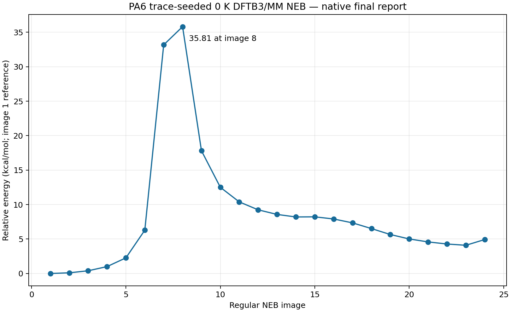
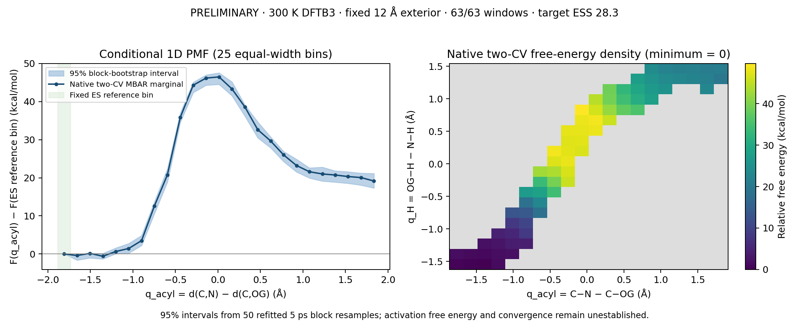

# Direct acylation: preliminary NEB and umbrella-sampling findings

Checkpoint: November 21, 2026. These are exploratory results, not a validated
activation barrier or an established Nyl12 mechanism. The PI requested that
the existing sampling continue unchanged.

## Potential-energy path used to seed sampling

The source is the historical 0 K DFTB3/3ob QM/MM direct-acylation NEB with
neutral Thr233 N-terminus and deprotonated Asp272/Asp274. The QM subsystem
contains 98 real atoms with charge −2. The original 12 Å movable region
(4,165 atoms) is retained; the exterior is frozen. This is not the later
ASP272/ASH274 water-assisted calculation.

The native optimizer reported convergence at cycle 477. The 24 regular images
rise from the E–S reference to **35.80895 kcal/mol at image 8**, then descend
to an acylenzyme endpoint **4.92846 kcal/mol above image 1**. Chemical endpoint
checks passed. The regular-band maximum alone is not a verified first-order
saddle point, and the separate TS-validation work remains a separate gate.



## Preliminary MBAR result

The frozen analysis contains **63/63 sampled windows**, **1,190 ps** accepted
production (10–30 ps/window), 23,800 saved frames and 5,003 statistically
thinned samples. The sampled overlap graph is connected at the diagnostic
edge threshold 0.001. The pooled unbiased-target effective sample size is
only **28.28**; this is not a per-window ESS.

MBAR removes the two native Amber umbrella biases using their exact piecewise
potentials. The primary profile is the marginal free-energy density along

\[
q_{\mathrm{acyl}}=r(C,N_{\mathrm{leaving}})-r(C,O_{\mathrm{Thr}}).
\]

The other biased coordinate is

\[
q_H=r(O_{\mathrm{Thr}},H_{\gamma1})-r(N_{\mathrm{leaving}},H_{\gamma1}).
\]

With 25 equal-width bins, the apparent maximum is **46.49584 kcal/mol** at
q_acyl = 0.01328 Å relative to the fixed E–S density-reference bin
[−1.88410, −1.73231] Å. Fifty within-window 5 ps block-bootstrap MBAR refits
give a pointwise 95% interval of **44.53939–47.55736 kcal/mol at that fixed
maximum bin**. This is not a confidence interval for a fully converged
activation free energy or for the maximum selected anew in each replicate.



Connected overlap permits this preliminary reconstruction but does not show
sampling convergence. Three windows (028, 030 and 032) have block-drift flags;
independent-start/hysteresis checks and convergence of slow orthogonal motion
remain unestablished. The confidence band does not include those systematic
uncertainties or Hamiltonian error. The reference is a histogram density bin,
not an integrated E–S basin. The 300 K PMF projection and 0 K NEB image maximum
use different observables and reference definitions; their difference is not
an isolated entropic correction. Neither presently supports a kinetically
plausible direct-acylation mechanism.

## Why alternative proton-transfer branches are sampled

The native distance-difference restraints are correctly applied with
k_acyl = k_H = 100 kcal mol−1 Å−2. Inside their harmonic ranges Amber uses
V = k(q−q0)², without an additional factor of 1/2; their outer tails are
linear. The inner target has r2 = r3, so there is no flat-bottom interval.
They bias collective variables rather than impose exact bonds or proton owners.

Neither CV contains the HG1–Thr233 N-terminal distance. Lengthening OG1–HG1
can increase q_H even when HG1 binds Thr's N-terminus instead of the substrate
nitrogen. Multiple component distances and chemical configurations can therefore
give the same difference. This is a coordinate degeneracy and competing
chemistry, not by itself evidence of a broken restraint or a need to increase k.
Finite thermal target deviations can occur as well; strengthening these same
two restraints cannot remove the degeneracy at equal CV values.

The frozen accepted-frame audit confirms that this is not merely hypothetical.
In the following HG1-on-Thr-N frames, the imposed q_H targets are closely
tracked while the HG1–leaving-N distances are too long for an N–H bond:

| Window | Frames | q_H target (Å) | Mean q_H (Å) | Mean OG1–HG1 (Å) | Mean leaving-N–HG1 (Å) |
| --- | ---: | ---: | ---: | ---: | ---: |
| 029 | 400 | 0.2870 | 0.2811 | 2.2453 | 1.9642 |
| 031 | 600 | 0.4568 | 0.4417 | 2.3578 | 1.9161 |
| 033 | 400 | 0.6265 | 0.5992 | 2.4365 | 1.8373 |

Their q_H root-mean-square target errors are 0.0521–0.0612 Å and mean
proton-coordinate bias energies are only 0.271–0.374 kcal/mol. Mean q_acyl
errors are −0.0155, −0.0087 and −0.0149 Å, respectively. Both imposed CVs
are closely tracked despite the alternative proton owner. Source rows are
the matching accepted-block observable CSVs in the frozen input snapshot.

The raw, biased-frame nearest-owner counts are 9,473 with HG1 closest to OG1,
11,836 closest to leaving N, and 2,491 closest to Thr N-terminal N. The latter
branch occurs in windows 028–034. These counts are not equilibrium populations.
All frames were retained. Consequently, the plotted marginal mixes proton
branches and is not a direct-route-only PMF. The two original N-terminal
hydrogens remain nearest that N in all but two recorded H2-owner assignments.

A geometric screen found 1,716 biased frames with HG1 nearest Thr N and both
C–OG1 and C–N below 1.7 Å. Those are TI1-like candidates only: the carbonyl
C–O length was not in the frozen scalar observables, no local minimum was
verified, and the raw frame count is not evidence of appreciable unbiased
TI1 occupancy.

## Decision and next checks

1. Continue the existing campaign to its authorized minimum of 30 ps/window;
   preserve all completed blocks and proton branches. Do not change biases,
   topology, proton inventory, or the movable region within this comparison.
2. Refresh MBAR, overlap, target ESS, proton-owner tracking and block stability
   as accepted blocks accumulate. Keep this frozen checkpoint for comparison.
3. Before any route-specific interpretation, resolve branch sampling using
   component distances and proton ownership. If a later campaign needs a
   branch-resolving coordinate or additional bias, specify and include that
   potential in the estimator explicitly rather than silently filtering data.
4. Do not promote a plausible-looking projection to a verified TS, stable TI1,
   converged PMF, or experimentally established mechanism.

At the live audit near 14:32 UTC, eight violet and 23 azalea US workers were
active; one azalea worker had completed its allocation. Completed production
was 8 windows × 10 ps, 54 × 20 ps, and 1 × 30 ps. All jobs were left running
unchanged. Actual current controller receipts are under
`dispatch/coverage_first_20261120/{violet,azalea}/`, not the retired worker paths.

## Reproduction and provenance

Canonical campaign (relative to repository root):

```text
qmmm/pa6_flipped_model30/05_neutral_reaction_path/
  07_dimer_ts_img07_img08_seed_20261113/irc_0K/new_neb/
  trace_seed_25img_step005_max4000_20261113/
```

The NEB source is `vmd_final_24img/final_24img/`, with
`scientific_acceptance.json`, `band_snapshot.json`, `reactive_distances.csv`
and the retained native report. US is its `umbrella_sampling/` child.
`analysis/pmf_latest/` resolves to the compact verified export from
`requested_mbar_20261121_stable_hist`; immutable accepted inputs and original
source snapshots are preserved in `requested_mbar_20261121/`.

The initial supplemental 1D result of 13.96 kcal/mol was invalidated before
display to the PI: weighted-histogram cumulative subtraction lost very small
probabilities. The retained invalidation receipt records the failed artifacts.
The corrected 1D calculation sums positive weights directly with `bincount`,
passes a 50-decade probability/order-invariance regression, and matches an
independent 2D histogram marginal to 1e−13 relative precision. This correction
does not alter raw sampling, native biases, or the frozen analysis inputs.

The versioned [evidence manifest](../provenance/neb_us_preliminary_20261121.json)
records source hashes and the compact summary. The versioned
[PMF table](neb_us_preliminary_20261121_pmf.csv) and figures are exact copies
of the accepted local artifacts. The laptop pull includes the compact export
at the same campaign-relative `umbrella_sampling/analysis/pmf_latest/` path.
