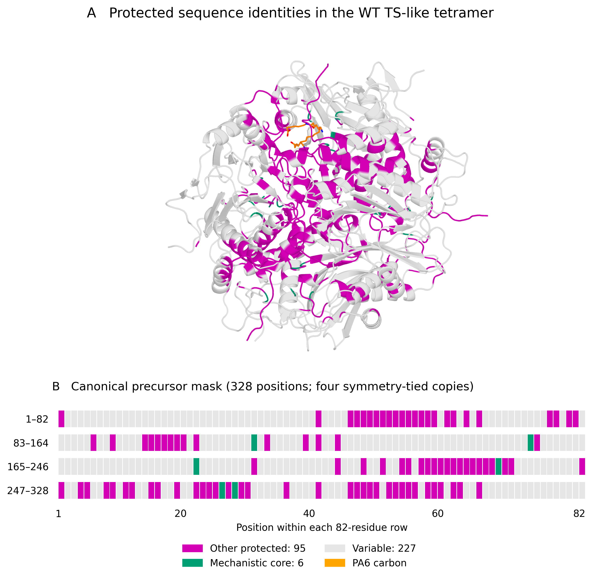

# Supporting information draft: N-terminal-relay acylation

Evidence cutoff: 27 November 2026; the detailed geometry/support audit uses
45 ps/window, with a separately identified later 50 ps main PMF checkpoint
and the first completed 10 ps supplemental checks. This is a methods and diagnostic record;
the PMF, TI1 assignment and transition-state interpretation remain provisional.
Dated historical analyses in Methods/Results are preserved. The current
[roadmap](../docs/NYL12_MECHANISM_ROADMAP.md) records subsequent execution status.

## Supplementary ipSAE2 qualification — 28 November 2026

This technical supplement has a later evidence date than the trajectory audit
above. ipSAE2 0.1.11 at commit
`fe560f4c2461eeb91aebded61ac8c1e83b264f60` passed 53 upstream tests and an
independent WT/design qualification. Native Boltz token records and token
pLDDT verified each 1444 × 1444 PAE matrix against its raw CIF. Negative
controls exchanged identical-copy blocks; these invalid mappings were rejected.
All original native artifacts retained identical hashes after scoring.

Original chain pairs, whole-protein and four mature-protomer groups were scored
with both PAE directions retained. Independent evaluation of 448 directional
values per model agreed with the six-decimal upstream TSV values within
5 × 10⁻⁷; repeated chain-pair scoring was byte-identical. Protein-only assembly
correspondence was necessary because native beta-chain pairing differed between
the two models. Protein-aligned whole-protein versus PA6 scores were:

| Native ligand ID | WT seed 20261126 | Design 06 seed 20261126 |
|---|---:|---:|
| I | 0.026397 | 0.017145 |
| J | 0.016310 | 0.011036 |
| K | 0.014456 | 0.009317 |
| L | 0.018853 | 0.013247 |

Each score includes all 33 ligand heavy atoms with d0 = 2 Å. Ligand IDs are
native output labels, not independently matched biological sites. These are
whole-ligand confidence descriptors, not catalytic rankings; four copies do
not constitute four independent predictions. No PA6-specific cutoff is imposed.
Commands, dependency lock, mapping evidence, numerical checks and limitations
are detailed in [the qualification record](../docs/IPSAE2_QUALIFICATION.md).

## Relay sampling and visualization checkpoint — 28 November 2026

| Cohort | Independent histories | Completed ps/history used | Frames after one 5 ps discard |
|---|---:|---:|---:|
| Original reaction-path windows |57|70|74,100|
| Corrective activation grid |33|10|3,300|
| Targeted opposite-start/product checks |4|25|1,600|
| Additional initialization checks |6|30|3,000|
| Total |100|cohort-specific|82,000|

All 43 supplemental histories contribute to the present global MBAR point fit;
none is excluded merely for being shorter than the main windows. Native
Hamiltonian, atom mapping and bias-energy parity are checked per completed
block. Physical observations, binning, E–S reference s=0.0125 and the one-time
5ps discard are unchanged. Repeat bias potentials are not independent new
bias locations;92 unique potentials are represented. No smoothing was applied.
Pooled pointwise intervals are not reported while each corrective-grid history
contains only one retained 5 ps block. The comparison figure's gray interval
is explicitly for the original 57 alone (200 full-MBAR 5 ps-block resamples).
The bin-local Kish weight ESS panel is not a temporal independence estimate.

The regenerated main-only movie contains 28 snapshots/window across 14 completed
production blocks (1,596 frames, 19,967 stripped atoms). Visualization includes
initial production sampling and must not be confused with the statistical
selection. The immutable 70 ps bundle passed topology/DCD dimension checks,
complete Tcl execution, atom mapping, camera-orientation and portable checksum
checks; graphical VMD rendering was unavailable. Supplemental movies remain
separate. Reusable source and acceptance records reside under
`analysis/review_20261128_01/` and `movie_70ps_refresh_20261128/` in the relay
campaign. The numerical refit converged; an additional figure-only assertion
initially assumed the reference was the first histogram bin. That guard was
corrected to validate the actual reference at index 10 without refitting,
renormalizing, dropping bins or altering any PMF values; failed logs are retained.

## S1. Scientific model, provenance and atom mapping

**Signed-angle definition and current pose reference.** Projected Herschlag
phi uses Thr OG1 and four coherently mapped substrate atoms: carbonyl O,
carbonyl C, amide N and the carbon bonded to carbonyl C on its acyl side.
Carbonyl C is projected onto the plane through O, amide N and acyl-side C;
the signed torsion is OG1 → O → projected C → acyl-side C, using the unchanged
project `atan2` convention. Thr Nα, HG1 and CB are not atoms in this phi.
The central L4 reference uses C54/O49/N59/C62; the recent terminal-amide
control uses C55/O50/N57/C63. The PI-approved Boltz B/F pose gives +81.196°
before and +88.228° after relaxation. Positive phi is the prospective E–S
design target. The opposite-sign numerical observations are preserved, and
this selection rule adds no phi bias to the reaction-path simulations.
The approved coordinate/image/math-source hashes and all eight before/after
Boltz reference measurements are retained in
`amber_relaxation_20261127/approved_positive_pose_reference_20261127.json`.

The modeled event is substrate acylation by catalytic Thr233, using its
alpha-amino group as a proton relay. It is separate from enzyme maturation
and from hydrolysis of the resulting acylenzyme. The hypothesis is that Nα
accepts the hydroxyl proton during activation and subsequently supplies a
proton to the leaving amide nitrogen. Labels track atoms; they do not require
that one particular hydrogen execute every transfer.

Terminology used throughout this campaign is defined as follows. **Nucleophile
activation/proton uptake** (the historical `activation` or A umbrella group)
means transfer of the Thr233 OG1 hydroxyl proton to the same residue's free
N-terminal alpha-amino nitrogen, Nα, coupled to OG1 attack on the substrate
amide carbonyl carbon. These motions need not be synchronous. **Leaving-group
protonation/acylation completion** (the historical `delivery` or D group)
means proton transfer from the N-terminal ammonium group toward the substrate
amide nitrogen, coupled to cleavage of the substrate C–N bond and formation
of the Thr ester acylenzyme. These are names for sampling segments and proposed
chemical changes, not independently established elementary steps. Neither
label refers to enzyme autocatalytic maturation. Atom HG1 is tracked, but
proton exchange can change which hydrogen completes the transfer.

**E–S** denotes the noncovalent enzyme–substrate complex; **TI1-like** denotes
a candidate tetrahedral adduct with a forming/formed OG1–carbonyl-C bond and
a retained substrate C–N bond, pending carbonyl geometry/electronic and stability
qualification. **Acylenzyme** denotes the covalent Thr233 ester after substrate
C–N cleavage. A **PMF** is a potential of mean force, or projected free-energy
profile. Here **s** is normalized progress along a geometrical reference in
three distance-difference coordinates; it is neither elapsed time nor a
validated probability of reaching product. A PMF **shoulder** is a reduced
slope; it is not by itself a local minimum or an intermediate. An optimized
potential-energy minimum and a metastable finite-temperature free-energy basin
are distinct claims.

All indices below are one-based in the unchanged full Amber topology.

| Role | Amber atom index | Residue mapping |
| --- | ---: | --- |
| Scissile carbonyl C | 19916 | P6I1314 C |
| Leaving amide N | 19929 | P6I1315 N |
| Catalytic OG1 | 13916 | canonical Thr233, Amber residue 929 |
| Original hydroxyl HG1 | 13917 | canonical Thr233, Amber residue 929 |
| N-terminal Nα | 13905 | canonical Thr233, Amber residue 929 |

The primary campaign [prepared manifest][prepared] retains source paths,
restart hashes, per-window centers and source-selection evidence. Its
`origin_paths` point to `12_nterminal_relay/model/inputs/optimized.ncrst`,
`system.prmtop` and `dimer.mdin`, with the parameter-release lineage retained
under the earlier `nterminal_relay_releases_20261123` directory. This historical
parent location does not make the relay path an NEB calculation. The frozen
preparation manifest includes preparation-time status fields; subsequent
launch/acceptance receipts, rather than those old flags, establish execution.

The physical model is DFTB3/3ob-3-1 QM/MM with 98 real QM atoms, eight link
atoms, QM charge −2 and zero electronic temperature. The full system contains
104,922 atoms; 4,165 atoms in the retained 12 Å active region are movable and
the exterior is fixed at the shared source coordinates. The QM region contains
no water. The region, topology, proton inventory, parameter release and
physical Hamiltonian are held constant across relay umbrellas and supplements.
The [manifest][prepared] retains the exact active mask, QM mask, frozen-file
and parameter hashes; the Hamiltonian identity is
`927a6e26d45b5db018db2dbb2b9bf5ce12b4f25e4b7e91b10a4d615903f9f5f0`.
Production uses native CPU Sander, 300 K Langevin dynamics (collision frequency
2 ps⁻¹), a 0.5 fs timestep and continuation of coordinates/velocities between
segments. There is no additional spatial restriction within the movable
region, q_del wall or proton-identity restraint. Valid proton exchanges are
retained and diagnosed, not removed to enforce the proposed mechanism.

## S2. How the initial path and umbrella centers were constructed

The common starting structure was the relaxed, force-converged window 033
configuration released from the earlier umbrella campaign. Its full minimum
qualification and accepted TI1 identity remain unresolved. Separate
coordinate-driven optimization branches were generated from that exact
restart: reverse activation toward E–S and forward proton delivery/C–N
cleavage toward acylenzyme. The original driving composites were

- reverse activation: d(Nα,H) − d(OG1,H) + d(C,OG1);
- forward acylation: d(Nα,H) − d(Nleave,H) + d(C,Nleave).

Only each composite was restrained during its corresponding drive; bond and
proton components could progress asynchronously. These driving coordinates
are distinct from the two-coordinate finite-temperature umbrella potentials
in S3. Reaction biases were removed at candidate endpoints for independent
force/connectivity assessment. The accepted source evidence is retained in
[inputs/seed_evidence][seeds], including recovered and unresolved electronic
convergence histories, endpoint geometry, proton ownership and frozen-exterior
checks. The two optimization branches reside in
`12_nterminal_relay/01_activation_reverse/` and `02_acylation_forward/`.

To order the full E–S→acylenzyme reference, the reverse branch was read from
its E–S endpoint back toward window 033 and joined to the forward branch at
the identical shared restart, counted once. The resulting geometrical
reference has 39 nodes in (q_acyl,q_act,q_del) space, with cumulative
arclength 7.675909 Å. Intermediate umbrella **centers** were interpolated;
atomic starting structures were selected from accepted restart candidates,
with center-to-seed offsets recorded. Atomic coordinates were not assumed to
be interpolated equilibrium structures. The source, every node and the
resulting centers are available in [prepared.json][prepared].

This construction supplied potential-energy-surface seeds and a plotting
reference. It was not a relay NEB, a sampled minimum-free-energy path or proof
of a continuous chemically accepted reaction trajectory. The shared restart
establishes the geometrical join, while continuity of individual components,
chemical retention, equilibration and initial-state independence require
separate checks. Neither force convergence nor the TI1-like label certifies a
stationary minimum. The direct-route campaign has a different history: its
initial structures came from a 24-image NEB. Seed-generation procedures alone
cannot establish or invalidate equilibrium PMF comparisons.

## S3. Collective variables, initial grid and exact bias convention

For distances d in Å, evaluated with the fixed atom map in S1,

\[
q_{\rm acyl}=d(C,N_{\rm leave})-d(C,O_{\rm G1}),
\]
\[
q_{\rm act}=d(O_{\rm G1},H_{\rm G1})-d(N_\alpha,H_{\rm G1}),
\]
\[
q_{\rm del}=d(N_\alpha,H_{\rm G1})-d(N_{\rm leave},H_{\rm G1}).
\]

Increasing q_acyl describes C–OG1 formation/C–N cleavage; increasing q_act
moves HG1 from OG1 toward Nα, and increasing q_del moves it from Nα toward
leaving N. These are distance differences, not bond-order assignments.
Unlabeled hydrogen-pool coordination and nearest-heavy-atom ownership remain
necessary when proton labels exchange.

| Initial chart | Windows | Biased coordinates | First → last centers (Å) |
| --- | ---: | --- | --- |
| Activation | 31 | (q_acyl,q_act) | (−1.58358,−1.03240) → (−0.07783,1.51662) |
| Delivery | 26 | (q_acyl,q_del) | (−0.07783,−0.92731) → (1.69211,1.27603) |

The original 57 centers follow two curves through the explored geometry,
not a rectangular sampling grid. The complete center list is authoritative
in [prepared.json][prepared]. Any center schematic depicts **bias centers,
not observed distribution overlap**; overlap must be measured from trajectories.
Native generalized-distance restraints apply

\[
U_k=25(q_{\rm acyl}-a_k)^2+25(q_j-b_k)^2
\quad\mathrm{kcal\ mol^{-1}},
\]

where j is act or del and k is the window index. Each coefficient has units
kcal mol⁻¹ Å⁻². Amber's convention has **no factor of one-half**; it is
equivalent to κ = 50 kcal mol⁻¹ Å⁻² in the convention U = ½κΔq².
A 0.1, 0.2 or 0.5 Å deviation in one restrained CV costs 0.25, 1.00 or
6.25 kcal/mol, respectively; simultaneous 0.2 Å deviations in both cost
2.00 kcal/mol. Native linear tails begin at center ±10 Å and must be retained
in cross-energy evaluation. The [native restraint example][restraint]
provides the exact atom order, signs, force coefficients and tail boundaries.
There is no RMSD-to-path potential, NEB spring or native bias on the plotted
path-progress variable s.

## S4. Production selection, reweighting and uncertainty

Each original window received separate 1 ps heating and 5 ps equilibration
stages, excluded from PMFs. Production is stored in consecutive 5 ps segments.
The primary analysis joins only accepted, physically continuous segments in
chronological order, checking restart/time lineage. It discards the first
5 ps of production **once per independent lineage**, then uses all remaining
frames through a common complete horizon. This is a specified provisional
discard, not evidence that every degree of freedom equilibrates in 5 ps.
Independent starts stay separate for discard and resampling even if their
bias potentials coincide. The 45 ps/window main analysis contains 45,600
retained configurations from 57 histories, not 45,600 independent observations.

Every frame supplies all three raw CVs. Every window's actual native two-CV
bias is cross-evaluated on every retained frame and checked against native
restraint energies/CVs before pooling. One global MBAR fit (PyMBAR 4.0.3)
normalizes both charts under the common physical Hamiltonian; separately
zeroed partial PMFs are never added. The common physical energy cancels in
relative biased-state energies because temperature and physical Hamiltonian
are identical; umbrella energies do not cancel. Actual per-state counts enter
the all-frame estimator.

For the original plotted profile, configurations are projected onto the
nearest segment of the frozen 39-node, three-CV polyline; normalized arclength
is reported as s. This is a density in a specified projected coordinate, not
a unique reaction coordinate. Corner projection and contributions from an
unrestrained third CV require explicit sensitivity tests. The E–S reference
bin, bin edges, projection and Hamiltonian are fixed across matched comparisons.

Two hundred resamples independently draw contiguous, nonoverlapping 5 ps
chunks with replacement within each lineage. MBAR is refitted for every draw;
200 analogous 2.5 ps-block refits test block-length sensitivity. Reported
pointwise 95% percentile intervals require support in every primary bootstrap
refit. Unsupported reference bins or disconnected overlap are failures,
not draws to discard silently. These are conditional intervals at fixed bins,
not simultaneous intervals for an optimized barrier maximum. No IID analytical
interval is assigned to the correlated all-frame estimator. Discard variants
(0, 2.5 and 10 ps) and early/late halves are sensitivity analyses; inconvenient
chemical excursions are not selectively censored.

Earlier automatic-truncation/thinning and blockwise analyses remain archived
in Methods/Results as historical sensitivities. The fixed-discard protocol
supersedes those choices for the current primary profile. References
[R55–R60](REFERENCES.md) support the equilibration, correlated-data and QM/MM
validation discussion; no literature window duration establishes convergence
of this particular enzyme/substrate system.

## S5. What ESS measures, and what it cannot establish

For unbiased MBAR weights w_i within bin B, the reported Kish ESS is

\[
N_{\rm Kish,B}=\frac{(\sum_{i\in B} w_i)^2}{\sum_{i\in B}w_i^2}.
\]

It measures weight concentration: a bin with many stored frames can have
ESS≈1 if one frame carries nearly all its weight. It does not account for
serial correlation. For a stationary scalar series, statistical inefficiency
is instead estimated as g=1+2Σ_t ρ(t), with a specified finite-lag estimator,
and N/g estimates its effective independent count. Different observables have
different g. Neither N/g nor Kish ESS counts transitions into unvisited states;
they cannot generally be equated or multiplied into a certified universal
sample size. Under drift, the stationarity assumption underlying g itself
fails. We therefore report per-bin weights, maximum-frame fractions,
contributing windows, physical observables and time comparisons together.

## S6. Diagnosed failures and corrective sampling

### Projection artifacts and sparse early support

At 45 ps/window, 29.736% of weight in the s=0.1625 bin projects exactly to a
reference-path corner. At s=0.2375 and 0.2625, one snapshot supplies 96.527%
and 92.591% of bin weight (Kish ESS 1.07 and 1.16). These features cannot be
assigned as physical intermediates. A validated differentiable BGP path
projection reduces vertex accumulation but does not replace missing sampling.
No smoothing was applied to manufacture a smoother primary PMF.

The physical-coordinate analysis uses the same global 45 ps MBAR weights;
its source receipts, 45,600 frame identities and primary PMF agree with the
published analysis (PMF reconstruction error 2.75×10⁻¹⁴ kcal/mol).
In the initial s∈[0.10,0.21) region, substantial motion in unrestrained q_del
changes the projected progress even while HG1 remains on OG1 and C–N remains
intact. Among nonzero weighted absolute projection-gradient contributions,
q_act/q_del/q_acyl contribute approximately 49.0/37.5/13.4%. Important sampled
configurations have q_acyl≈−1.5 to −1.75 Å outside the existing center curve.
A global q_act marginal aliases reactant-like and product-like states;
initial-leg maps therefore explicitly condition −2≤q_acyl<−0.8 Å, with a
−1.0 Å upper-cutoff sensitivity. These conditional maps have their own density
measure/reference and are not a replacement whole-reaction barrier.

[Physical-coordinate diagnostic and full tables][physical] and
[initial-leg map][initialfigure] distinguish projection effects from missing
support. [Whole-profile sensitivity figure][physicalfigure] compares the hard
projection, differentiable projection and physical maps. Sample-density maps
show observed reweighted configurations; center overlays only show imposed
bias locations and cannot demonstrate overlap by themselves.

### Four targeted checks and product-tail support

Two reciprocal activation starts and two product-tail extensions completed
5 ps equilibration plus 10 ps production with no unresolved SCC errors. Their
wrappers exited 1 **after native completion** because the wrapper Python
lacked `pidfd_open`; process failure and native scientific completion are
recorded separately. Reciprocal activation q_del histogram intersections of
0.136/0.262 reveal persistent initialization dependence despite small local
drift. Product extensions retained acyl geometry, with q_del intersections
0.266/0.300. They are continuing in place toward 30 ps with retained velocities.

A controlled pooled fit holds the original 57 histories at 45 ps and adds the
four 10 ps checks, applying a separate 5 ps production discard to each. It
raises the two tail-bin weight ESS values from approximately 1.34/1.96 to
54.81/15.01 (s=1.0375/1.0625). This demonstrates improved weight support,
not endpoint equilibration. Only one retained 5 ps block exists in each
10 ps supplemental history, so the specified 5 ps-block CI is unresolved.
At 15 ps production two blocks become available, still weak uncertainty
evidence. The [pooled diagnostic][pooled] is distinct from the primary PMF.

### Thirty-three additional activation umbrellas

The early-support correction adds a 3×11 rectangular grid:
q_acyl={−1.25,−1.50,−1.75} Å and q_act={−1.0,−0.8,…,+1.0} Å. Both native
coefficients remain 25 kcal mol⁻¹ Å⁻²; no extra q_del or proton-identity bias
is introduced. The [selected-seed manifest][selected] records 29 unique
accepted native restart seeds selected from 248 candidates, with topology,
receipt and source hashes and the dimensionless two-CV bias-distance metric.
The [seed chemistry audit][seedchem] checks atom counts, fixed exterior,
physical coordinates and tracked/unlabeled proton ownership. Choosing a
nearby seed reduces initial strain; it does not establish its equilibrium
probability. The [center map][centermap] shows that these additions occupy an
area beside the original curved center line, rather than inserting centers
only between one adjacent pair. For example, an important rare configuration
from A014 at production 9.05 ps has q_act = −0.5766 Å and q_acyl = −1.4694 Å;
the new center (−0.6, −1.5) Å in that coordinate order lies nearby. More
negative q_acyl permits less advanced attack at the same proton-transfer
coordinate, providing coverage outside the prescribed initial center line.
All 33 new trajectories use 5 ps equilibration and 30 ps
production in 5 ps segments, with the original Hamiltonian and 300 K protocol.

At this cutoff the 57 original histories continue on Azalea and the 33 new
histories plus four targeted continuations run on Violet. A controlled
94-lineage monitor freezes main histories at 45 ps to isolate added-support
effects. At common supplemental 10 ps it produces points/support only; from
15 ps it can perform paired 5/2.5 ps block refits. It retains independent
lineage resampling, cross-energy parity and paired coordinate projections.
This controlled comparison is not the final most-extensive analysis.

### Additional late-activation drift

The [five-distance audit][distances] uses all 45,600 retained native frames;
its movie-matched subset has 5,130 frames, with six independent DCD spot checks
agreeing within 1.95×10⁻⁷ Å. Comparing production 5.05–10 ps with 40.05–45 ps:

| Window | Δmean HG1–Nleave (Å) | Histogram intersection | Δmean C–OG1 (Å) |
| --- | ---: | ---: | ---: |
| activation_full_026 | +1.534 | 0 | +0.122 |
| activation_full_027 | +1.536 | 0 | +0.186 |
| activation_full_028 | +1.616 | 0 | +0.168 |

Intersections use 0.05 Å distance bins. HG1 stays about 1.05 Å from Nα;
these changes identify slow geometrical rearrangement rather than another
HG1 transfer. Estimated full-lag gΔt reaches approximately 11.76 ps for
HG1–Nleave, but drift makes that estimate uncertain. Five-/2.5 ps bootstrap
blocks cannot establish stationarity or reliable uncertainty under these
conditions. This late-activation problem is additional to the early region
targeted by the 33-state grid. [Distance traces][distancefigure] and
[per-window distributions][distributionfigure] preserve the evidence.

## S7. Present interpretation and prospective validation gates

The 45 ps/window profile has a sampled maximum of 25.803 kcal/mol at s=0.6875,
with conditional pointwise 95% interval 25.159–26.307 kcal/mol at that bin.
Temporal-half maxima are 24.807/26.653 kcal/mol. These differences, sparse
support and orthogonal drift preclude a converged activation-free-energy claim.
The [primary PMF][pmffigure] is a provisional density reconstruction, not a
validated transition state or rate prediction.

Qualification requires connected overlap **and** adequate local reweighted
support; stationary chemical/environmental observables; opposite-start and
late-block agreement; and uncertainty checks that cover the observed slow
timescales. The final most-extensive analysis must pool all accepted main
60 ps and supplemental 30 ps histories when available, retaining one 5 ps
discard per lineage and adding appropriately specified ≥10 ps-block or
independent-start checks. The frozen-45 ps diagnostic cannot substitute for
that analysis. If drift persists, extend or change sampling on the documented
physical coordinates rather than silently discarding it.

The new activation grid alone cannot validate early projection behavior,
late-activation mixing, product-tail equilibration or the s≈0.6875 bottleneck.
TS-region chemical retention, orthogonal-coordinate support and initialization
dependence need explicit assessment. Prospective committor tests must specify
reactant/product basins, unbiased release conditions and uncertainty; matched
embedded DFT/MM checks address Hamiltonian sensitivity. No committor result
or validated first-order saddle is claimed here. Reactant preorganization
also requires sampling: a barrier conditioned on a selected relay-ready E–S
pose is not automatically the barrier from the dominant bound ensemble.

## S8. Transition-region audit and additional initialization controls

The highest occupied bin of the frozen 45 ps profile spans s = 0.675–0.700.
It contains 649 configurations with Kish weight ESS 309.17. D008, D009 and
D007 contribute 41.33%, 35.38% and 17.14% of its unbiased statistical weight,
respectively; D010 and D006 contribute 5.13% and 1.03%. The neighboring
full-CV MBAR overlaps D007–D008, D008–D009 and D009–D010 are 0.254, 0.222 and
0.226. Across D007–D010, first/last retained 5 ps shifts in the five distances
are at most 0.063 Å and histogram intersections range from 0.77 to 0.96.
The right-flank bin s = 0.725–0.750 is less well supported (Kish ESS 33.89).
Activation windows A026–A028 supply no local frames over s = 0.6375–0.7375,
although their sampling can influence the global MBAR normalization.

The exact peak configurations are HG1-nearest to Nα in the retained record:
5th–95th percentile Nα–HG1 distances are 1.132–1.232 Å and leaving-N–HG1
distances 1.434–1.621 Å. Their C–N distances span 1.675–1.967 Å over the same
quantiles. These are conditioned reactive geometries, not a committor-verified
transition-state ensemble. Better local geometrical stability than in A026–A028
does not resolve the approximately 1.85 kcal/mol early/late shift in the
globally normalized PMF maximum. Initial exploratory heavy-atom design inputs
can be drawn from structurally qualified clusters here, but equilibrium
populations or catalytic improvement are not established by this selection.

A subsequent matching-protocol 50 ps checkpoint gives 25.910 kcal/mol at
s = 0.6875, with 738 configurations, Kish ESS 362.15 and conditional pointwise
95% interval 25.286–26.495 kcal/mol. Its early/late maxima are 24.877/26.964
kcal/mol, a 2.087 kcal/mol difference. The small 45→50 ps point-estimate
change (0.107 kcal/mol) therefore does not establish convergence. This later
result is from `analysis/fixed_burnin_20261126/fixed_50ps_analysis.json`, not
the separate preliminary native checkpoint analysis with a different scope.
The detailed distance/window-contribution audit above remains explicitly the
frozen 45 ps data set.

Six independent-start controls were prepared at unchanged target biases:

| Target bias | New starting configurations | Purpose |
|---|---|---|
| A026 | Original PES seed and accepted late MD restart | Compare near/far leaving-group configurations |
| A028 | Original PES seed and accepted late MD restart | Repeat the geometrical-memory check farther along activation |
| D008 | Accepted late D010 restart | Approach the peak from a leaving-N-associated HG1 state |
| D009 | Accepted late D007 restart | Approach from the Nα-associated side |

Actual HG1–leaving-N seed distances are 2.077/3.792 Å for A026 and
2.001/3.345 Å for A028. In the selected late D010 restart HG1 is 1.200 Å
from leaving N and 1.452 Å from Nα; this differs from the earlier frozen
45 ps D010 endpoint, so the actual selected restart was audited explicitly.
The late D007 distances are 1.105/1.622 Å to Nα/leaving N. Each new history
uses fresh recorded velocities, 5 ps equilibration and 30 ps production;
original histories and their prior discards are unchanged. There are no new
proton-identity restraints or changes in physical Hamiltonian.

The six controls were first queued on Azalea behind the 57 original 60 ps
histories. On 27 November the PI additionally authorized Geranium CPU use,
so a Geranium-specific preparation was validated and the six CPU jobs started
at 11:03 EST, avoiding the queue delay. Geranium's Sander and all 16 used 3ob files match
Violet; executable, Python and linked-library identities are retained per host.
The 20-step native D008 compatibility calculation passed all SCC, finite
energy/temperature, checkpoint/frozen-exterior and native bias-parity checks.
The exact idle Azalea queue controller was then retired before the six jobs
started, preventing duplicate execution. The other user's GPU work is untouched. Earlier
unlaunched host preparations are retained; different runtime hashes are not
silently rebound. The controls have not yet produced production MD results at
this documentation cutoff. Inputs and inventory are in
`full_path_300K/mixing_checks_20261127/` and
`analysis/mixing_checks_preparation_20261127/`.

The planned final candidate reconstruction uses all accepted main 60 ps,
33-grid 30 ps, four earlier-check 30 ps and six initialization-control 30 ps
histories: 100 independent lineages and 84,200 retained configurations at the
specified output cadence, retaining the initial 5 ps discard once per lineage.
The final100 watcher is active but no final fit has occurred. Its Geranium
source mirror and explicit host/preparation binding are isolated from the
original Azalea compact synchronization; stale unlaunched metadata was detected
by provenance checks before fitting and retained separately. Equal bias centers do not merge their time histories.
Count-preserving circular moving-block refits at 5 and 10 ps [R63] are implemented
to assess longer correlations without discarding remainder frames. They remain
conditional diagnostics when records drift; the identical final estimator must
also be applied to the direct route before quantitative mechanism comparison.
Fixed-length circular blocks are used, not geometric-length stationary-bootstrap
blocks. Wrapped indices preserve eligibility of the end of each record, and
only the resampled sequence is truncated to the original frame count.
No automatic promotion to a converged PMF is made. The original 57-window
5/2.5 ps nonoverlapping-block results and frozen-45 ps controlled diagnostics
remain separately identifiable. Native-acceptance, initialization, overlap,
coordinate-sensitivity and temporal-support checks are prerequisites for
interpreting a final barrier. If independent starts demonstrate that the
provisional 5 ps discard is insufficient, the all-frame fit remains diagnostic.
Any revised equilibration selection must be justified by structural/stationarity
and initialization evidence, with the same rule applied to both mechanisms;
it must not be chosen to reduce a barrier or improve visual smoothness.
Persistent distinct configurations at identical biases would motivate further
sampling of the unresolved Nα/leaving-group geometry rather than uniform
extension of the entire path.

## S9. Shoulder, shallow hump and temporal-half interpretation

The [feature audit][features] reuses the primary 50 ps/window analysis and
its paired bootstrap draws without refitting or changing the primary PMF.
Each independent trajectory retains its single initial 5 ps production discard.
Separate global MBAR fits to the first and second halves of retained time give
maxima of 24.877 and 26.964 kcal/mol, respectively, both at s = 0.6875.
Thus the reported 2.087 kcal/mol temporal shift is a change in estimated
barrier **height relative to the same E–S reference**, not movement of the peak
to another reaction coordinate. Correlations between halves and unresolved
structural drift preclude treating these as independent experimental estimates.
Small within-history bootstrap intervals do not cover missing configurations.

At 50 ps, s = 0.3875, 0.4125 and 0.4375 have PMFs of 19.771, 19.934 and
20.309 kcal/mol: the s ≈ 0.4 feature is a shoulder, not a local minimum.
The maximum at s = 0.5375 is 22.573 kcal/mol and the subsequent minimum
at s = 0.5875 is 21.487 kcal/mol. Their paired difference is 1.086 kcal/mol,
with conditional 95% intervals 0.867–1.259 (5 ps blocks) and 0.885–1.272
(2.5 ps blocks). The drop persists in the early and late halves, 0.985 and
1.196 kcal/mol. It cannot simply be dismissed as independent-bin noise.

However, a separate frozen-45 ps projection diagnostic assigns 37.4% of the
weight in the s = 0.575–0.600 trough region exactly to reference-path vertices.
Reprojection of the identical weighted configurations onto the differentiable
path coordinate removes this local hump/trough at two tested smoothing scales;
the third retains only an approximately 0.19 kcal/mol drop. This changes the
coordinate mapping and associated density/Jacobian, not the underlying samples
or their MBAR weights. Coordinate sensitivity is evidence against interpreting
this one-dimensional feature as an established chemical intermediate or
additional transition state; it does not establish that the real free-energy
surface is featureless. Do not select the coordinate to obtain visual smoothness.

The exact shared window033 reference structure maps to s = 0.537776 (node
20, zero-based), near the hump rather than the s ≈ 0.4 shoulder. In the
weighted 45 ps geometry audit, the shoulder region s = 0.375–0.425 has mean
C–OG1 = 2.120 Å and substrate C–N = 1.429 Å, with HG1 associated with Nα.
Later bands s = 0.5125–0.5375 and 0.550–0.575 have mean C–OG1 = 1.738
and 1.636 Å and C–N = 1.519 and 1.555 Å, respectively, also with HG1 on Nα.
These support progressive addition with retained C–N connectivity; distances
alone do not verify tetrahedral hybridization, a stable TI1 or a transition
state. Carbonyl C–O geometry and electronic structure are not in this cached
five-distance table. Geometry uses 45 ps data; the quoted primary PMF uses
50 ps data. A force-converged TI1-like PES structure need not generate a
resolved metastable basin in a projected finite-temperature PMF [R54].

For redesign, retain a small, structurally clustered set from the main
s ≈ 0.675–0.700 barrier region and consider a separate exploratory earlier
addition/proton-transfer set from s ≈ 0.4–0.6. The interval is a search band,
not a declaration that every configuration is a transition state. Identify
distinct chemically relevant configurations rather than pool frames uniformly.
Cross-evaluate whole sequences across those templates and E–S/acylenzyme
compatibility controls under the existing bounded budget. Avoid optimizing
intermediate binding alone: excessive intermediate stabilization can increase
the free-energy cost of the following step. The relevant kinetic quantities
are transition-state free energies relative to populated basins and the
coupled reaction network, not simply the two highest plotted ordinates.

## S10. WT prediction controls for downstream redesign validation

The existing WT control budget comprised two fixed seeds, 20261126 and
20261127, in each of Boltz-2 and AlphaFold3. Each input contained four
232-residue alpha chains, four mature 96-residue beta chains beginning with
Thr233, and four noncovalent zwitterionic PA6 L4 ligands. Query-only protein
MSAs were supplied, without homologous sequences, templates, contact
restraints, covalent enzyme–substrate bonds or TS-coordinate guidance.
Boltz 2.2.1 used three recycling steps, 200 sampling steps and one diffusion
sample per seed. AF3 3.0.1 used three recycles, one diffusion sample and a
1536-token bucket without its data pipeline. Existing model checkpoints
matched the retained workstation release byte for byte. All four successful
outputs are unrelaxed structural controls; no MM, MD or QM/MM acceptance is
implied. Original AF3 compiler failures and corrected-runtime retries are
retained in operational provenance rather than treated as chemical results.

Output acceptance checked exact canonical protein sequences, eight mature
protein chains, four 33-heavy-atom ligand chains, atom-name/element maps,
finite coordinates and absence of unintended covalent protein–ligand bonds.
Physical alpha–beta partners were independently assigned by protein-only core
contacts, evaluating all 24 one-to-one permutations. All four models uniquely
supported AE/BF/CG/DH; ligand distances were not used for protein pairing.
All fitted crystal-core residue identities matched. An ALA/PRO difference
at reference H228 outside the fitted core was retained in the sequence audit;
it does not explain the gross pocket discrepancies reported here.

Every internal amide was identified from the validated source graph: three
amides per L4, four ligands and four sites give 48 evaluations per model.
The existing one-to-one ligand/site assignment maximizes Tier A/B counts,
then favorable tier and then minimum total d1. With all evaluations rejected,
the assigned rows are bookkeeping summaries rather than validated bound poses.
d1 is Thr233 OG1–substrate carbonyl C; d2 and d3 are substrate carbonyl
O–Phe113 backbone N and O–Asn186 ND2, respectively. Alpha_BD is
OG1–carbonyl C–carbonyl O. Signed Herschlag phi uses the same coherently mapped
amide atoms throughout; neither its sign nor native-Thr similarity is an
additional hard gate. N-terminal N–leaving-N and CB–OG1–carbonyl-C values are
also retained in the [complete comparison][wtcomparison].

| Predictor / seed suffix | AE d1 (Å) | BF d1 (Å) | CG d1 (Å) | DH d1 (Å) | Assigned A/B/C |
| --- | ---: | ---: | ---: | ---: | --- |
| AF3 / 26 | 12.52 | 12.64 | 12.38 | 12.16 | 0/0/0 |
| AF3 / 27 | 10.78 | 10.73 | 10.82 | 10.81 | 0/0/0 |
| Boltz / 26 | 20.45 | 28.26 | 10.16 | 12.12 | 0/0/0 |
| Boltz / 27 | 15.30 | 17.29 | 18.30 | 14.86 | 0/0/0 |

All 16 assigned rows and all 192 raw evaluations reject even Tier C; all
assigned rows fail d1, d2 and d3. The Phe113 N–Asn186 ND2 separation, which
does not depend on substrate placement, is 19.86–20.34 Å and 18.56–18.68 Å
in the two AF3 controls, 14.47–17.86 Å and 9.92–10.37 Å in Boltz, and
3.83–3.88 Å across the four n12c reference sites. This identifies a
protein-pocket modeling limitation in the tested protocol. It is not
evidence against experimental WT activity or the independent MD/QM/MM parent
structures. Homologous protein MSAs and protein-only crystal-template inputs
are proposed controlled diagnostics; the present data do not establish the
cause of the prediction failure. Additional mutant ranking should not rely
on these failed WT controls. Full pairing matrices, raw/assigned metrics,
source/input hashes, scripts and verification records are retained together.

### Canonical identity, sequential Amber exports and exhaustive amide selection

The original four raw controls were measured using verified native protein
sequences and ligand-graph atom correspondence. Full Amber heavy-input
exports were added subsequently; the earlier models were not already certified
Amber topologies. Each inspection bundle now retains raw CIF, canonical
biological PDB/CIF, mature-local PDB, modular Amber heavy input and complete
conversion/acceptance maps. Biological chains A–D contain precursor 1–232 and
E–H contain 233–328; mature-local beta chains use 1–96. The existing modular
converter assigns sequential dry Amber residues 1–1312 to protein and 1313–1328
to four PA6 L4 molecules (P6N/P6I/P6I/P6C each). Consequently catalytic E233
corresponds to mature-local E1 and Amber 929. One-ligand TS parents instead
contain 1,316 dry residues. These different stoichiometries must not share a
blind residue-offset rule.

Roundtrips checked atom identity, source graph, coordinates and catalytic
metrics. AF3 coordinates/metrics were unchanged; Boltz PDB component rounding
was at most0.0005 Å, distance differences below0.00095 Å and angle differences
at most 0.119°. Canonical raw-precision CIF remains available. After Amber,
the matching topology, restart and conversion map must recover canonical
identity before RFD3/MPNN; a matching dry topology is used after stripping a
solvated system. These heavy exports do not assign hydrogens/protonation or
certify a force field for MD.

Every three-amide/four-ligand/four-site combination is retained. The global
one-to-one ligand/site summary differs from independently choosing the nearest
d1 amide at two of 16 original sites, so both summaries are published. For
Boltz seed 20261126, BF changes from globally assigned d1=28.265 Å to nearest
d1 = 17.348 Å and DH from 12.119 Å to 9.021 Å; all remain rejected. Thus the poor WT
control geometry does not arise from forcing a designated scissile amide.

### Protein-only conditioning follow-ups

One matched seed per predictor uses the existing protein MSAs: 3,137 aligned
alpha records and 4,913 beta records. Exact WT queries, lowercase insertions,
gaps and unpaired homolog status are preserved; no paired alignment is
invented. Both native predictions and canonical/metric roundtrips completed,
with zero assigned Tier A/B sites. The prespecified pipeline-adequacy response
is one protein-only crystal-template follow-up per failing predictor, not
additional unguided ligand contacts or a change in tier thresholds.

Templates derive from the observed n12c four-copy assembly and are split into
eight mature chains without inventing missing residues or averaging copies.
All 9,426 observed protein heavy-atom coordinates are retained exactly; the
reference H228 ALA/query PRO difference remains explicit. AF3 accepts one-chain
templates and therefore receives eight separate mature-chain templates without
an interchain assembly constraint. Boltz receives a nonforced joint protein
template; its native alignment coverage is recorded. No substrate, water,
additive or designed TS coordinates enter the templates. A process or identity
failure stops the follow-up rather than silently substituting a different
method. All stages require independent process and geometry acceptance.

### Completed protein-template controls — 27 November 2026

Both predictors completed their single matched-seed protein-template follow-up,
with homologous protein MSAs and four unguided PA6 L4 molecules. Native
identity/graph, physical alpha–beta pairing and canonical/sequential Amber
coordinate/metric roundtrips passed. These are unrelaxed models; four sites
within one prediction are nested observations, not independent prediction
replicates. Table values use the exhaustive 48-amide/ligand/site analysis and
the resulting one-to-one assignment, which here matches the independently
nearest-d1 choice at every site. Each chosen amide is source C55/O50/N57;
this outcome was determined from the graph and geometry, not imposed.

| Predictor | Site / ligand | d1 (Å) | d2 (Å) | d3 (Å) | αBD (°) | Signed φ (°) | Nα–leaving-N (Å) | Tier |
| --- | --- | ---: | ---: | ---: | ---: | ---: | ---: | --- |
| AF3 | AE / I | 2.673 | 2.538 | 3.466 | 81.06 | −102.12 | 5.354 | C |
| AF3 | BF / J | 2.687 | 2.535 | 3.451 | 80.48 | −103.98 | 5.326 | C |
| AF3 | CG / K | 2.695 | 2.532 | 3.457 | 80.55 | −102.97 | 5.359 | C |
| AF3 | DH / L | 2.666 | 2.527 | 3.443 | 81.68 | −103.81 | 5.300 | C |
| Boltz | AE / I | 2.745 | 2.888 | 4.102 | 65.38 | +89.46 | 5.317 | reject |
| Boltz | BF / J | 2.799 | 3.079 | 4.156 | 56.02 | +81.19 | 5.528 | reject |
| Boltz | CG / K | 2.705 | 2.896 | 4.015 | 66.27 | +86.71 | 5.241 | reject |
| Boltz | DH / L | 2.791 | 3.082 | 4.100 | 59.19 | +78.19 | 5.459 | reject |

AF3 has four Tier C and 44 rejected raw combinations; Boltz has 48 rejected
combinations. Neither has an A/B combination anywhere. For AF3, the attack
angle is the only failed A/B tier criterion: the existing A and B ranges are
90–120° and 85–125°, respectively. Nα–leaving-N remains a diagnostic rather
than a tier gate. The consistently negative AF3 and positive Boltz phi values
identify opposite local substrate orientations under the same amide mapping.

Protein-only Phe113 N–Asn186 ND2 distances are 3.715–3.729 Å in AF3 and
3.559–3.582 Å in Boltz, compared with 3.831–3.883 Å in the four available
n12c author chains A/F/H/V. These ranges support recovery of pocket geometry
relative to the failed query-only controls; they do not establish catalytic
competence. No unverified per-chain correspondence to crystal author labels
is assumed. Exact comparison, atom identities, roundtrip receipts and output
hashes are in the [template audit][templateaudit].

AF3 inference completed at 18:51:16 UTC. The first completion watcher failed
because it recursively required exactly one model CIF, whereas the standard
AF3 output contained both the top-level model and its sole seed/sample copy.
A retained postprocessing retry explicitly selected the native top-level
model and verified exact identity and coordinates for all 10,060 atoms against
the sample copy; file hashes differ because their headers differ. The retry
completed publication at 19:24:03 UTC without rerunning inference or relaxing
coordinates. This operational correction changed no prediction or tier rule.

[templateaudit]: ../design/nyl12_relay_ts_ensemble_20261126/broader_pilot/wt_protein_template_controls_20261127/audit_summary_20261127.json

### Matched fully unrestrained Amber relaxation

Both protein-template controls completed the common ff19SB/TIP3P/modular
RESP-GAFF2 minimization and met the RMS target of 0.05 kcal mol⁻¹ Å⁻¹:
AF3 0.047702; Boltz 0.045807. The complete batch and canonical before/after
publication exited zero at 20:25:39 UTC on 27 November. All four neutral Thr
termini, eight anionic catalytic Asp residues, four zwitterionic L4 molecules,
twelve internal PA6 links and neutralized solvated-system charge passed the
existing topology gates. No positional/contact restraints or frozen atoms
were used. The protocol is described in Methods.

Entries below are before → after. d1 is OG1–carbonyl-C, d2 is carbonyl-O–Phe113-N,
and d3 is carbonyl-O–Asn186-ND2. Units are Å for distances and degrees for angles.

| Predictor | Site | d1 | d2 | d3 | αBD | Signed φ | Tier |
| --- | --- | --- | --- | --- | --- | --- | --- |
| AF3 | AE | 2.673 → 3.022 | 2.538 → 2.895 | 3.466 → 4.322 | 81.06 → 73.59 | −102.12 → −80.19 | C → reject |
| AF3 | BF | 2.687 → 2.954 | 2.535 → 2.867 | 3.451 → 4.266 | 80.48 → 74.51 | −103.98 → −80.98 | C → reject |
| AF3 | CG | 2.695 → 2.980 | 2.532 → 2.897 | 3.457 → 4.161 | 80.55 → 79.68 | −102.97 → −89.07 | C → reject |
| AF3 | DH | 2.666 → 2.915 | 2.527 → 2.898 | 3.443 → 4.196 | 81.68 → 77.36 | −103.81 → −98.02 | C → reject |
| Boltz | AE | 2.745 → 2.970 | 2.888 → 2.905 | 4.102 → 2.891 | 65.40 → 101.49 | +89.48 → +85.41 | reject → A |
| Boltz | BF | 2.799 → 2.950 | 3.079 → 2.844 | 4.156 → 2.934 | 56.02 → 106.80 | +81.20 → +88.23 | reject → A |
| Boltz | CG | 2.706 → 2.911 | 2.896 → 2.853 | 4.015 → 2.970 | 66.24 → 100.46 | +86.71 → +84.20 | reject → A |
| Boltz | DH | 2.791 → 2.930 | 3.082 → 2.842 | 4.100 → 2.994 | 59.16 → 108.26 | +78.20 → +87.37 | reject → A |

The four selected source amides remain C55/O50/N57 in ligands I/J/K/L at
sites AE/BF/CG/DH, respectively. Fixed-identity all-48 comparisons exclude
selection switching as the explanation. Assigned and independently nearest-d1
choices agree in both models before and after relaxation. Across all 48 raw
combinations, relaxed Boltz has four A plus 44 rejects; relaxed AF3 has 48
rejects. The other combinations contain no hidden A/B candidate.

Boltz Nα–leaving-N distances shorten from 5.241–5.528 Å to 3.767–3.965 Å;
AF3 distances lengthen from 5.300–5.359 Å to 5.760–6.386 Å. Boltz remains in
the positive-phi class, matching the PI-approved target orientation. Tier
criteria and signed-pose selection must therefore remain separately reported.
These static matched-minimization outcomes do not establish binding persistence,
proton-relay accessibility, a transition state, or improved catalytic activity.
Coordinate rounding in the Boltz initial Amber PDB accounts for sub-milliångström
differences from the earlier raw-precision CIF table.

Per-case sources, native force acceptance and immutable canonical before/after
PyMOL bundles are under
`wt_protein_template_controls_20261127/amber_relaxation_20261127/`. The native
1328-residue dry topologies/restarts and exact conversion maps were used for
recanonicalization; the canonical original chain assignment and independently
verified physical pairing are retained. JSON is authoritative, CSV is tabular.

## S11. Current eligible supplemental MBAR and verified movie publication

The first pooled progress fit used 57 main histories at 50 ps and four earlier
supplemental histories at 10 ps: reciprocal activation starts
`activation_021_from_022` and `activation_022_from_021`, and product-side
`delivery_027_qdel_1p50` and `delivery_028_qdel_1p75`. Native bias-prefix energy
parity and source identities were verified before fitting. Independent starts
at identical bias centers remain distinct histories; this gives 61 histories
but 59 distinct bias potentials. Each independent history discards its first
5 ps of production once, retaining 51,700 frames total. Longer continuations
do not repeat this discard. No new 33-grid or six Geranium history was yet
production-eligible at this checkpoint.

The pooled maximum is 25.913245kcal/mol at s = 0.6875, compared with 25.909932
for the main-only estimate. A pooled block interval is withheld because each
newly eligible history retains only one 5 ps block. The plotted main-only 95%
band is labeled accordingly; it is not a pooled uncertainty estimate. The
main-only peak interval 25.286–26.495 kcal/mol remains conditional on the sampled
histories and does not cover unresolved initialization/projection bias.
Main-only early/late maxima 24.877 and 26.964 kcal/mol still indicate drift.

An accepted-source-signature updater checks every 180 s, incorporating each
supplemental history individually after at least10 ps accepted production and
native parity checks, and using the latest common published main horizon.
It makes a new fit only when accepted inputs change. Immutable checkpoints
retain exact per-history horizons, source hashes and uncertainty limitations.
The final 100-history reconstruction (main 60 ps; supplements 30 ps), 5/10 ps
block-sensitivity and independent-initialization checks remain separate gates.

The main inspection movie contains 5,700 frames (100 per main 50 ps history),
and the separate four-check clip contains 80 frames (20 per10 ps history).
Independent windows/starts are explicitly ordered for inspection, not presented
as one dynamical trajectory. Viewers use0.2 Å sticks/dynamic bonds, orange
substrate carbons, white H/blue N/red O, explicit QM–MM C–C and protein CA–CB
display bonds, no depth cueing and disabled chain-colored cartoons. The pull
script resolves each producer's verified immutable generation once and checks
that generation's manifest; it does not mix mutable files during transfer.

## S12. Experimental scope, binding-register history and archived templates

The PA6 L4 model was chosen for computational tractability and motivated by
observed L4 products and the hypothesis that further cleavage could yield
L2+L2. It is not a demonstrated enzyme-specific L4→L2 reaction. Nyl12 has been
reported to produce substantial L3 as well as L2 and L4. In the supplied
commercial-polyamides manuscript's high-throughput I.DOT/OPSI-MS method,
the listed PA6 MRM targets are L2, L3 and L4; PA6 L1 is not listed. Lack of a
reported L1 signal under that method cannot establish absence of L1 formation.
Separate assay formats, standards and detection limits must remain distinct.

| Source carbonyl-C / leaving-N | Bond between repeat units | Fragment lengths for L4 |
| --- | --- | --- |
| C52 / N58 | 1–2 | L1 + L3 |
| C54 / N59 | 2–3 | L2 + L2 |
| C55 / N57 | 3–4 | L3 + L1 |

The original contact-guided models and current relay Hamiltonian use the
middle bond; recent unrestrained template controls select the third bond.
These assignments follow the validated whole-L4/modular mapping and explicit
amide graph, not atom-number proximity or an assumed Amber site. A finite
four-repeat model does not determine how far a real substrate extends on
either side or establish endo/exo selectivity. Register remains recorded for
every pose; different registers are not pooled as one reaction-path/PMF model.

The commercial manuscript discusses loops 95–103 (old merged-copy chain D)
and 289–300 (old chain B). In the retained eight-chain TS-like assembly,
their nearest counterparts around the A/E occupied site are D-alpha95–103
and F-beta289–300, at minimum ligand heavy-atom distances 3.62 and 2.77 Å.
Thus the relevant context includes neighboring subunits. The PI prioritizes
95–103 for any future loop-length test and 289–300 next. Current work instead
uses coordinate-only template masking with full protein queries.

Historical CIFs in `/data/jpc/enzyme-substrate-modeling/old_config/cif/` were
inventoried rather than assumed equivalent from their filenames:

| Template | Author chains | Relevant limitations |
| --- | --- | --- |
| `Nyl12_tetramer-symgen_no_tail.cif` | A/B/F/G | Alpha223–232 omitted; loop95–103 only partly absent |
| `2_loops/xx23.cif` | A/B/F/G | Partial95–103 coverage; also omits151–164 and293–300 |
| `3_loops/x125.cif` | A/B/F/G | Omits95–104,115–121,151–164; retains289–300 |
| `4_loops/xall.cif` | A/B/F/G | Additional omission at293–300; not a single-loop mask |
| `Nyl12_refine13_no_tail.cif` | A/B | Two source chains; incomplete tails/native gaps |
| `all_loops/xxxx.cif` | A/B | Similar observed residue coverage to refine13; name is not an exact all-loop specification |

All contain nonprotein PEG/PGE and water records and no PA6. Author-chain
labels are not assumed equivalent to prediction chain labels. None exactly
provides the controlled95–103/alpha-tail-only mask used for the new screen;
that mask was derived explicitly from the validated protein-only mature
assembly, retaining every other coordinate. Exact source hashes, residue
inventories and manuscript paragraph extracts are in
`docs/evidence/commercial_polyamides_20261127/`.

Numerous capped/register variants already exist in the earlier modeling
project. A retained capped example contains `lig_sub.lib`, `lig_sub.frcmod`,
`leap2.in`, `complex_min.pdb` and `energy.json`; its LEaP recipe loads GAFF.
Its exact historical fitted-charge provenance is not yet certified, despite
AM1-BCC being a plausible legacy workflow. No capped RESP/GAFF2 release is
claimed. These archived structures/parameters are preserved for later
assessment rather than mixed into current quantitative force-field/PMF work.

[wtcomparison]: ../design/nyl12_relay_ts_ensemble_20261126/broader_pilot/dgx_wt_control_qualification_20261127/comparison_20261127/comparison_report.md
[features]: ../qmmm/pa6_flipped_model30/12_nterminal_relay/umbrella_sampling/full_path_300K/analysis/shoulder_hump_audit_20261127/audit.json
[prepared]: ../qmmm/pa6_flipped_model30/12_nterminal_relay/umbrella_sampling/full_path_300K/prepared.json
[seeds]: ../qmmm/pa6_flipped_model30/12_nterminal_relay/umbrella_sampling/full_path_300K/inputs/seed_evidence/
[restraint]: ../qmmm/pa6_flipped_model30/12_nterminal_relay/umbrella_sampling/full_path_300K/activation_full_001/03_production_5ps/umbrella.RST
[physical]: ../qmmm/pa6_flipped_model30/12_nterminal_relay/umbrella_sampling/full_path_300K/analysis/fixed_burnin_20261126/physical_coordinate_diagnostic_20261127/README.md
[initialfigure]: ../qmmm/pa6_flipped_model30/12_nterminal_relay/umbrella_sampling/full_path_300K/analysis/fixed_burnin_20261126/physical_coordinate_diagnostic_20261127/initial_leg_physical_diagnostic.png
[physicalfigure]: ../qmmm/pa6_flipped_model30/12_nterminal_relay/umbrella_sampling/full_path_300K/analysis/fixed_burnin_20261126/physical_coordinate_diagnostic_20261127/physical_coordinate_diagnostic.png
[pooled]: ../qmmm/pa6_flipped_model30/12_nterminal_relay/umbrella_sampling/full_path_300K/analysis/pooled_support_20261127/README.md
[selected]: ../qmmm/pa6_flipped_model30/12_nterminal_relay/umbrella_sampling/full_path_300K/analysis/activation_support_preparation_20261127/selected_seeds.json
[seedchem]: ../qmmm/pa6_flipped_model30/12_nterminal_relay/umbrella_sampling/full_path_300K/analysis/activation_support_preparation_20261127/seed_chemistry_acceptance.json
[centermap]: ../qmmm/pa6_flipped_model30/12_nterminal_relay/umbrella_sampling/full_path_300K/plots/activation_support_centers_20261127/activation_support_centers.png
[distances]: ../qmmm/pa6_flipped_model30/12_nterminal_relay/umbrella_sampling/full_path_300K/plots/reaction_distance_statistics_45ps_20261127/README.md
[distancefigure]: ../qmmm/pa6_flipped_model30/12_nterminal_relay/umbrella_sampling/full_path_300K/plots/reaction_distance_statistics_45ps_20261127/reaction_distances.png
[distributionfigure]: ../qmmm/pa6_flipped_model30/12_nterminal_relay/umbrella_sampling/full_path_300K/plots/reaction_distance_statistics_45ps_20261127/per_window_distributions.png
[pmffigure]: ../qmmm/pa6_flipped_model30/12_nterminal_relay/umbrella_sampling/full_path_300K/plots/relay_45ps_fixed_burnin_20261127_pmf.png

## SI: Protected-residue inventory and TS-ensemble redesign gates

**Figure Sx. Protected and variable sequence positions in Nyl12.** Magenta
denotes 95 other protected identities, teal highlights the six-position
mechanistic subset (F113, K156, N186, T233, D272 and D274), and very light gray denotes
227 variable identities; PA6 carbon is orange. The six-position subset includes
proposed mechanistic roles, not six independently proven Nyl12 catalytic
residues. Together magenta and teal comprise all 101 protected identities.
The structure is a complete modeled WT TS-like parent, not
an experimental structure or a verified first-order saddle point. All 328
precursor positions are represented in each of four copies. One PA6 TS-like
context is shown; the separate E–S prediction controls have four ligands. The sequence
barcode uses the same mask. Protected sequence identity does not imply frozen
backbone coordinates. Camera orientation, white background, 0.2 Å sticks,
source mapping and input/code hashes are retained in the figure-generation
script, PML/PSE and manifest.

The mask fixes 101/328 precursor positions (30.8%; 404 physical residues in the
tetramer) and leaves 227/328 variable. It contains 24 core policy positions and
77 additional recurring interface positions. Core policy comprises the 17
explicit hydrolysis/tail positions plus seven conservative context positions
(M1, K156, T234, L235, G273, V275 and L276). No disulfide constraint was detected. The
82-position recurring-contact set overlaps the 24-position core at five
positions, so its union is 101, not 106. Inter-repeat contact requires a protein
heavy-atom separation ≤4.0 Å in at least three of four equivalent copies in
each of three original TS-like parents, excluding intrinsic A/E, B/F, C/G and D/H
alpha/beta pairs. This is a conservative assembly-design heuristic, not a
claim of experimental essentiality or sequence conservation at every site.
It can restrict active-site-loop sequence freedom; any later interface
co-design comparison requires an explicit revised mask and assembly validation.

**Table Sx. Exact protected WT identities, canonical precursor numbering:**

M1, Q41, I46, Q47, G48, G49, S50, V51, G52, T53, F54, F55, T56, Q57, E58, K59, Q61, Q62, E64, Y66, I77, L78, L80, E81, S88, F91, K96, N97, E98, V99, Q100, F101, R102, M104, F113, Y115, M121, Y123, K126, K156, L157, N186, K195, K208, N212, V215, L218, L219, Q221, P222, K223, K224, P225, F226, W227, P228, E229, P230, K231, N232, T233, T234, L235, P246, R247, K250, Q251, R254, Q255, H257, H258, S261, Q262, H265, A268, T269, I270, L271, D272, G273, D274, V275, L276, R282, D287, G292, A293, D294, I295, E296, D298, L299, N300, A301, K302, I304, Y305, L306, M308, V309, E312

The complete 328-row JSON/CSV inventory includes all overlapping reasons,
chain-local numbering and equivalent copies. Full figure caption, runnable
builder and current census are in
[the figure/inventory bundle](../docs/figures/nyl12_sequence_protection_20261127/SI_caption_and_inventory.md).
The gap-aware NylC-to-Nyl12 mapping is retained separately; reference-construct
mutations and alignment gaps are explicit. A simple fixed numbering offset
was not assumed. Homologous activity/maturation evidence must be distinguished
from direct evidence in Nyl12.

The current design workflow excludes RFD3. Its candidate pool comprises the
12 fixed-backbone LigandMPNN designs from two chemically coherent MD-derived
TS-like parents, with the 101-position protection mask and identical sequences
across all four copies. Thermal conformational asymmetry is allowed; exact D2
coordinates are not imposed on MD snapshots. Parent acceptance independently
requires reaction mapping, proton inventory, ligand graph and catalytic geometry;
multiple chain conformations alone do not establish TS compatibility. Historical
RFD3 remodels and their 12 sequences remain diagnostic artifacts outside this
current pool; no replacement generation or RFD3 qualification is required.

Fixed-backbone LigandMPNN design followed by independent template-free,
paired-MSA Boltz prediction and matched Amber relaxation can assess
sequence-driven repacking and assembly; it does not promise improved activity.
Only clear evidence of a backbone limitation would motivate a future controlled
RFD3 comparison evaluating coupled perturbations of A/E, B/F,
C/G and D/H, with independent physical-movement, clash, assembly, fixed-context
and chemical checks. It is not implemented or qualified for production, and
exact coordinate symmetry is not a universal acceptance requirement.

The operational stage sequence is TS-like ensemble selection → canonical/graph
qualification → two original MD-derived backbones (12 existing designs) →
symmetry-tied LigandMPNN → pooled sequence audit/diversity triage → small
matched template-free Boltz cohort → canonical/clash preflight → matched
Amber relaxation → canonical remeasurement/filtering → few independent MD
comparisons → PI experimental nomination with expression, maturation and
activity checks. Selected QM/MM/path tests and US/MBAR are optional before
experiments if resources permit, or may follow measured improvement to explain
mechanism; neither a PMF nor a verified PES TS is an experimental prerequisite.
Computed barrier-improvement claims require matched, supported WT/design
calculations, including post hoc protocols not tuned to assay outcomes. OpenMM
is an available separately qualified alternative to Amber,
not an extra mandatory relaxation. Exact reused entry points, budget limits
and acceptance records are described in the
[protocol](../docs/NYL12_TS_ENSEMBLE_REDESIGN_PROTOCOL.md).

The [Negoro critical-residue audit](../docs/nylc_critical_residue_audit_20261127.md)
and its gap-aware JSON/CSV mapping distinguish cleavage-normalized hydrolysis
measurements from maturation-confounded activities, assembly effects and
engineering substitutions. The catalytic and maturation constraints retained
by this audit are covered, including F101/M104 in the recurring-contact mask;
other tested engineering modifiers need not be fixed. The audit does
not infer that every tested NylC site is essential or transfers the same
mechanism to Nyl12.

The strict interface mask also fixes sites T53, F55, K59 and F101, for which
active variants have been reported in the project's provisional lysate data.
Consequently, this mask defines a conservative comparison rather than
experimentally established immutability. Discordant K59E duplicates and the
limitations of the lysate/MS assay prevent strong activity rankings. Any later
relaxation of interface protections should be tested explicitly while retaining
the catalytic/maturation core and verifying assembly.

## WHAM and early-region diagnosis — 28 November 2026

The matched finite-bin WHAM comparison used the exact previously displayed
70 ps main + 43 supplemental-history pool, rather than introducing additional
sampling during the estimator comparison. The source and report package is
`analysis/wham_comparison_20261128/` in the relay campaign. Main observations:

| Analysis | Projected maximum (kcal/mol) | Maximum early difference from MBAR (kcal/mol) |
|---|---:|---:|
| MBAR |26.2800|reference|
| WHAM, 0.1 Å cells |26.1755|1.0044|
| WHAM, 0.05 Å cells |26.3026|0.3700|
| WHAM, 0.025 Å cells |26.2943|0.1101|
| WHAM, 0.0125 Å cells |26.2837|0.0994|
| WHAM, finest grid shifted half-cell |26.2703|0.0238|

All maxima occur at s=0.6875. Values are point-estimator diagnostics, without
implied physical precision. Fixed-point residuals are at most 1.96×10⁻¹³ kBT.
The finest-grid origin sensitivity is 0.1232 kcal/mol at s=0.2625; this
exceeds the declared 0.1 diagnostic and is not suppressed. The existing
PyMBAR engine solves the discrete WHAM likelihood; this is not an independent
numerical-software validation. The primary comparison uses original-frame
projection; a separately labeled figure reports cell-center projection.

The dominant early-bin frame is native frame 52 (zero-based row 51), at
native time 12.60000038 ps / production age 7.60 ps, from
`activation_support_3_03/04_production_5ps`. Its source bias centers are
(q_acyl,q_act)=(-1.75,-0.6) Å, with 25 kcal mol⁻¹ Å⁻² on each coordinate.
The exact harmonic/linear-tail adapter gives bias energy 2.72712 kcal/mol,
consistent with native bias parity and the source rounding bound. SCC and
source acceptance passed. q_del was unrestrained in that window, and this
frame lies in the tail of its sampled q_del distribution. Its hard-s bin
weight is 96.84%, but it supplies only 4.283% of the corresponding physical
q_act bin when the explicit q_acyl conditioning boundary is expanded.
Boundary sensitivity (lower q_acyl bound -2, -2.05, -2.10 Å; upper bound -0.8)
retains a monotonic conditional q_act profile over -1.05 to +0.25 Å; maximum
change is 0.414 kcal/mol. This does not prove the unconditional path feature
spurious. Exact source mappings, ranges, weights and boundary choices remain
in the diagnostic JSON/CSV and retained scripts.

A nearest-segment polyline projection can assign a finite volume to an exact
vertex, producing an atomic component of projected probability. The measured
early vertex contains 25.89% of its histogram-bin probability; its calculated
0.179 kcal/mol effect explains only part of the 3.524 kcal/mol feature.
Neither smoothing the coordinate nor choosing coarse WHAM bins establishes
physical intermediates. No frames, bins or restraints were removed or changed.

### Physical-distance audit of early projected bins — 28 November 2026

The unchanged 100-history, 82,000-frame pool was interrogated using original
atom mappings and global MBAR weights. The dominant frame at s=0.254986
(histogram center 0.2625) has the following distances:

| Distance | Å |
|---|---:|
| OG1–HG1 | 0.9521 |
| HG1–leaving-N | 4.1486 |
| Nalpha–HG1 | 1.7658 |
| OG1–scissile-C | 3.3707 |
| Scissile C–N | 1.3690 |

These are E–S-like distances, despite the 1.670 Å transverse displacement;
there is no demonstrated chemical-invalidity basis for rejecting this accepted
frame. Its local Kish weight ESS is 1.066 and its normalized bin weight is
96.84%; Kish ESS is not an autocorrelation-corrected independent-frame count.
At s=0.2875, nearest-Nalpha HG1 ownership is 90.327% by raw count but
0.13797% by unbiased weight; nearest-OG1 ownership is 99.862% by weight.
Both original Nalpha hydrogens remain nearest Nalpha in every raw observation
and all weighted mass in the five selected diagnostic bins. This control does
not establish electronic bond orders or the identity of a product state.

From s=0.1125 to 0.1625, weighted mean OG1–C rises 2.5205→2.8989 Å,
whereas O–H remains approximately 0.995 Å and C–N approximately 1.37 Å.
Nucleophile retreat thus contributes to progress in projected s without proton
transfer in this comparison. The lowest existing corrective q_acyl center is
-1.75 Å, versus -2.0018 Å for the dominant observation; more main-history
sampling alone need not supply the missing local support. These descriptors
assign neither an intermediate nor a transition state and do not resolve all
early PMF features. Full raw/weighted distance statistics and bin support are
in `analysis/reaction_distances_20261128/distance_statistics.json`,
`bin_diagnostics.json` and `diagnostic_interpretation.json` within the relay
campaign. MBAR remains the primary estimator; the WHAM comparison above is
retained as an estimator diagnostic.

To test the identified reactant-side coverage gap, six additional histories
were initialized at (q_acyl,q_act)=(-2.0,-1.0), (-2.0,-0.8) and
(-2.0,-0.6) Å, each from the original E–S geometry and the provenance-checked
rare E–S geometry. Both starts have the same proton inventory. Native Amber
coefficients are 25 kcal mol⁻¹ Å⁻² on each restrained coordinate, with no
one-half factor; q_del is unrestrained. These histories retain the same physical
Hamiltonian and frozen exterior. Fresh velocities at 300 K are followed by
1 ps equilibration, 4 ps continued equilibration and 30 ps planned production.
A separate diagnostic collector retains the fixed 5 ps production discard once
per history and compares common 10/15/20/25/30 ps new-history prefixes with
the frozen original 100-history pool. This registers 106 histories and 95
distinct bias potentials. Execution and registration are not sampling-convergence
results; short-prefix diagnostics do not supply qualified pooled confidence
intervals. The unchanged primary PMF retains every accepted observation.
